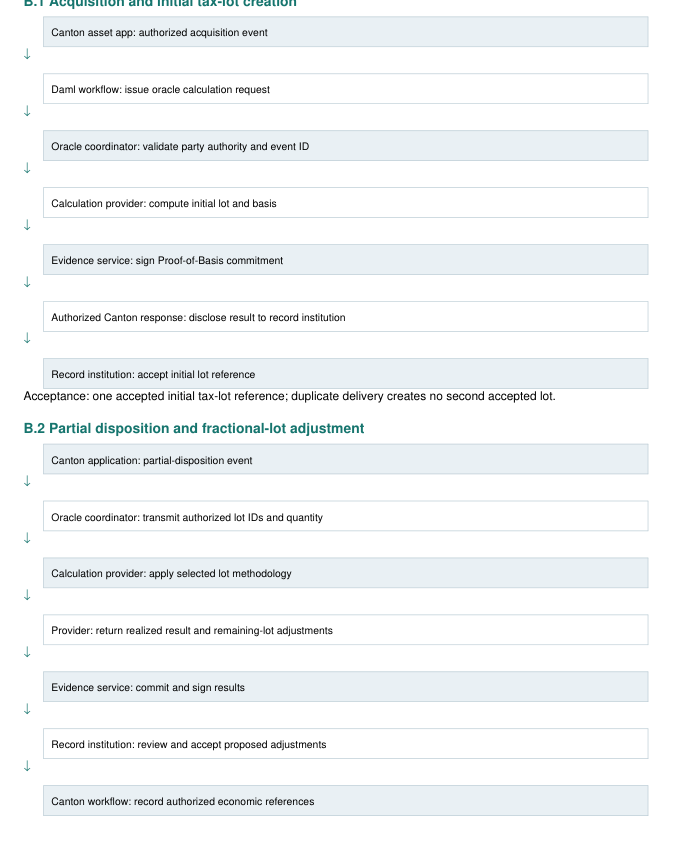
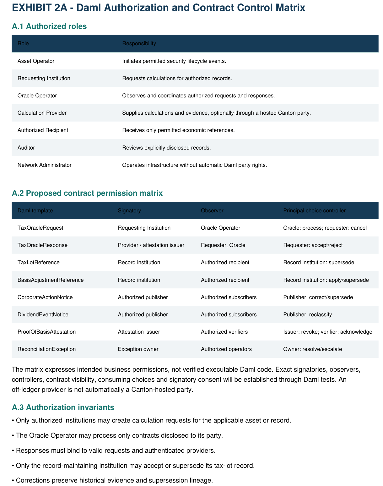
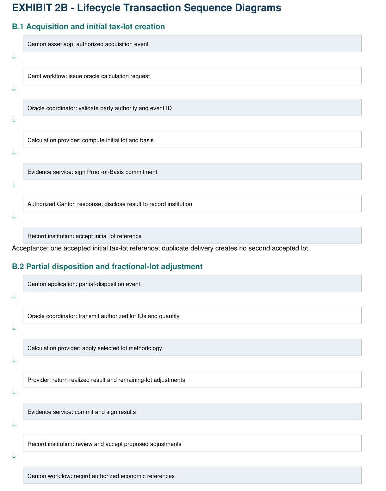
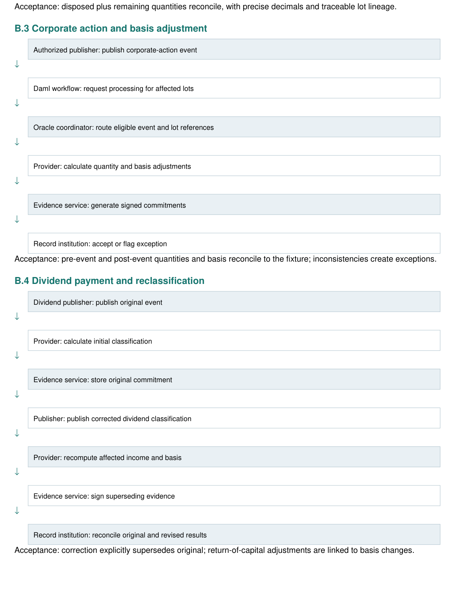
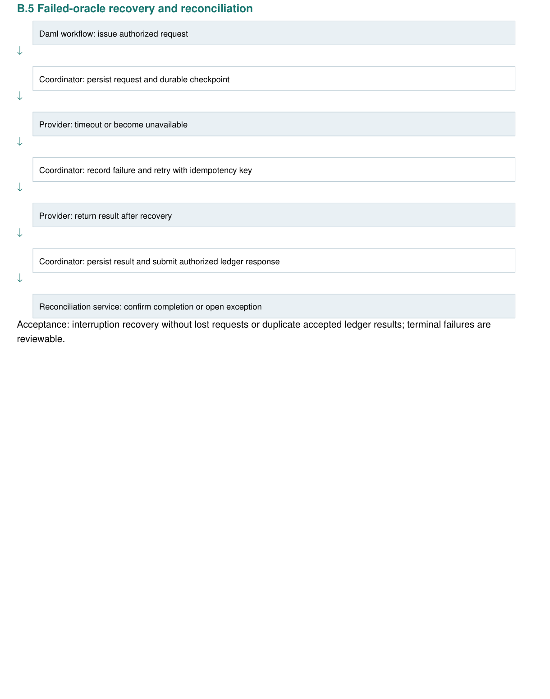
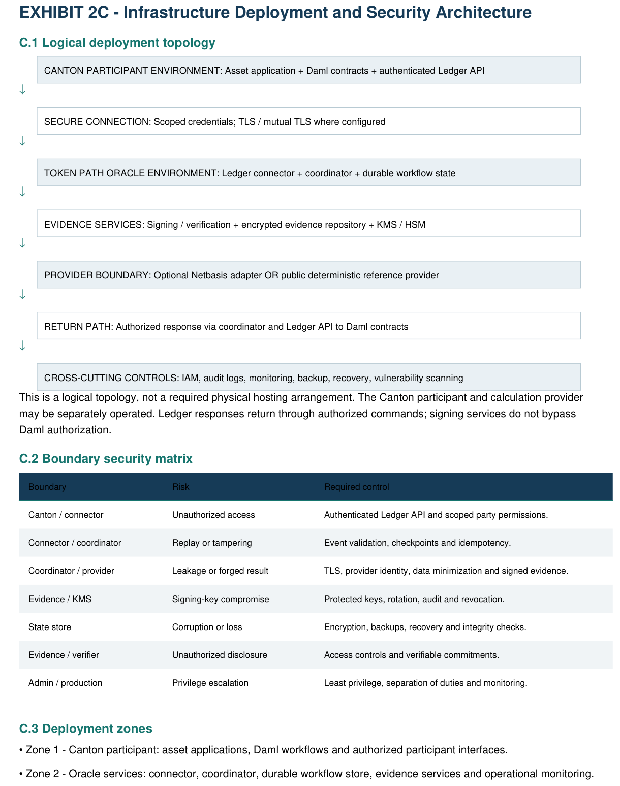
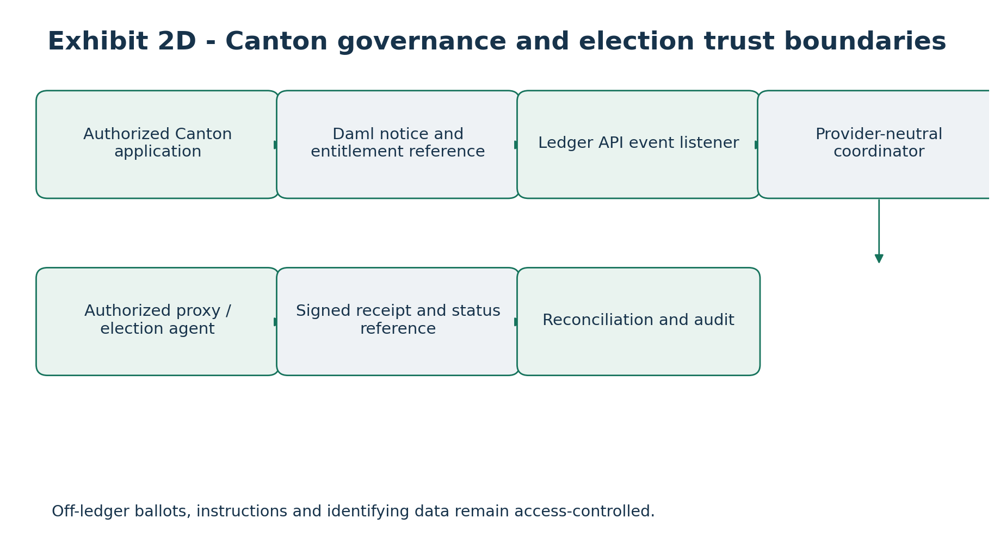
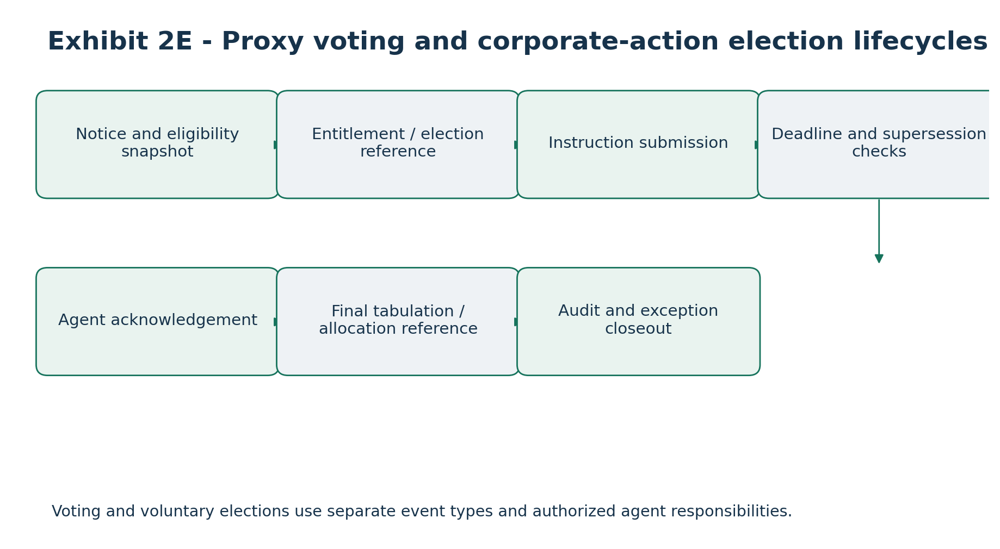

# Detailed Technical Architecture, Daml Authorization and Proof-of-Basis Trust Model

Canton Open Tax-Lot Interoperability and Proof-of-Basis Infrastructure

Document field Value

Applicant Token Path LLC

Development period 24 weeks

Grant request Up to 1,900,000 CC

Version 2.0 - Expanded Technical Architecture

Status Proposed; not deployed, compiled or security audited

Contents 31 sections and Exhibits 2A, 2B, 2C

# 1. Executive Technical Architecture

The proposed open-source Canton-native framework connects authorized Daml application events with institutional

economic-data calculation services through provider-neutral interfaces. The three distinct records are Canton ownership and transaction state, off-ledger institutional economic-data state, and cryptographically verifiable evidence and reconciliation state.

Design goals: privacy; Canton authorization; minimal on-ledger investor data; independent providers; calculation

provenance; lifecycle continuity; exception reconciliation; independent public operation without Netbasis; third-party integration; reproducible open-source testing.

# 2. Technical Scope and System Boundaries

In scope: Daml contracts, Ledger API connector, event normalization, durable oracle coordination, canonical calculation

API, deterministic mock provider, lot and basis references, corporate actions, dividend reclassification, signed Proof-of-Basis, reconciliation, deployment tooling, tests and documentation.

Out of scope: replacing Canton settlement or custody, acting as transfer agent, independently establishing legal title,

reproducing Netbasis proprietary calculations, complete tax-return filing, guaranteed legal correctness based solely on signatures, unsupported cross-chain functionality and publication of investor records.

Assumptions: authorized Canton identities, separately authenticated providers, lawful institutional data access, version-pinned SDKs and technical review of hosting, key management and retention.

# 3. Six-Layer Reference Architecture

Layer 1 - Canton/Daml: authorized application contracts, request and response lifecycle, event and attestation references, visibility controls.

Layer 2 - Ledger API: event subscriptions, filters, normalization, checkpoints, command submission, correlation and retries.

Layer 3 - Oracle coordination: schema and authority validation, provider routing, idempotency, state tracking, evidence orchestration and reconciliation.

Layer 4 - Calculation providers: deterministic public reference provider, independent third-party adapters and optional

proprietary Netbasis adapter.

Layer 5 - Evidence: canonical input/output commitments, identity, signatures, key references, verification, versioning and

supersession.

Layer 6 - Cross-cutting operations: IAM, encryption, secrets, monitoring, audit logs, exception management, backup and

recovery.

# 4. End-to-End Transaction Processing Model

1\. Authorized application creates an economic event and Daml request. 2. Ledger connector observes the disclosed event and persists a checkpoint. 3. Coordinator validates authorization, event and asset identity, schema, provider eligibility and idempotency. 4. Coordinator routes a canonical request. 5. Provider returns a versioned economic result. 6. Evidence service signs canonical commitments. 7. Authorized party submits the ledger response. 8. Reconciliation matches

request, calculation, evidence and ledger outcome. 9. The workflow completes or records a controlled exception.

A transfer need not synchronously block on an off-ledger calculation unless the participating application explicitly requires

that behavior. A transfer does not, by itself, prove the transferee inherited the transferor basis.

# 5. Daml Contract Architecture

Eight proposed application templates: TaxOracleRequest (requesting institution, oracle operator, event and asset

references, input commitment, deadline); TaxOracleResponse (provider, result, evidence and status); TaxLotReference

(opaque lot, quantity and basis commitment, version); BasisAdjustmentReference (prior and revised lot versions);

CorporateActionNotice (event and authorized publisher); DividendEventNotice (income and reclassification version);

ProofOfBasisAttestation (provider and signed evidence reference); ReconciliationException (severity, owner, resolution state).

Exact signatories, observers, controllers, consuming choices, archival semantics and visibility require executable Daml validation; these are conceptual specifications rather than compiled code.

Contract template Proposed purpose

TaxOracleRequest Authorized request and calculation reference

TaxOracleResponse Provider result and evidence correlation

TaxLotReference Opaque lot state and basis commitment

BasisAdjustmentReference Versioned basis-affecting event

CorporateActionNotice Authorized lifecycle event

DividendEventNotice Income classification and correction

ProofOfBasisAttestation Signed provenance evidence

ReconciliationException Controlled discrepancy and resolution

# 6. Daml Authorization and Visibility Model

Distinct roles include asset operator, requesting institution, oracle operator, calculation provider, authorized recipient,

auditor and infrastructure administrator. Off-ledger provider identity is not automatically a Canton party identity.

Validate separately: ledger-level authority, API authentication, provider eligibility, data entitlement and evidence

verification rights. Knowledge of an opaque reference does not itself grant access to underlying confidential data.

# 7. Proposed Contract Lifecycle

Create authorized request; acknowledge/accept according to the implemented Daml workflow; process externally; submit correlated authorized response; associate signed evidence; reconcile; version any corrections and preserve superseded

history; finalize as completed, rejected, superseded or exception.

Contract archival, replacement and correction rights must be explicitly defined and tested rather than assumed from

generic application logic.

# 8. Canonical Economic-Data Model

Asset master: asset identifiers, issuer, security and token references, currency and quantity precision. Tax lot: acquisition reference/date, original and remaining quantity, original and adjusted basis, selection method, holding-period reference

and version. Economic event: category, effective date, affected lots, amount, source and processing version.

Use specified decimal representations, not binary floating point, for monetary and fractional quantities. Basis-affecting updates require immutable version references and documented rounding conventions.

# 9. Proof-of-Basis Evidence Architecture

Proposed manifest: schema version, attestation/request/event/lot references, calculation type, provider identity,

calculation version, input and output commitments, timestamp, signing-key ID, signature and optional restricted evidence locator.

Verification checks schema, signature, recognized and authorized key, request correlation, disclosed data commitments,

and current/superseded status. A valid signature establishes provenance and integrity of signed data; it does not certify market-data accuracy, tax-law correctness, legal data rights or uncompromised key custody.

Avoid guessable unsalted commitments over low-entropy sensitive values. Final canonical serialization, signature profile and key revocation semantics are open design decisions.

# 10. Provider-Neutral Calculation Architecture

Public endpoints will support acquisitions, lot retrieval, dispositions, basis adjustments, corporate actions, dividend

classification, evidence and reconciliation. The public deterministic reference provider uses synthetic inputs and documented rules.

Netbasis may connect via a separate optional adapter without exposing proprietary source or data. Independent providers

can implement the same public interface; provider selection follows explicit institutional authorization and configuration, with no silent substitution of methodologies.

# 11. Acquisition Workflow

An authorized acquisition event initiates request validation, provider lot creation, evidence signing, ledger response and reconciliation. Illustrative synthetic fixture: 100 shares acquired with total adjusted basis \$10,010; evidence binds the

acquisition input to the resulting initial lot reference.

# 12. Partial Disposition Workflow

For an illustrative 100-share lot with \$10,010 total basis, a 25-share disposition with \$3,000 proceeds allocates \$2,502.50 basis and \$497.50 gain, leaving 75 shares with \$7,507.50 basis. This example assumes proportional allocation within the

selected homogeneous lot.

The provider must preserve lot selection, quantity conservation, adjusted basis continuity, versioning and auditable

evidence.

# 13. Fractional-Lot Processing

Support fractional acquisitions and dispositions, precise basis allocation, explicit decimal scale, documented rounding, residual quantity tracking and tolerance-based reconciliation. The canonical interface must define both numerical

representation and permitted rounding behavior.

# 14. Corporate-Action Processing

Event interfaces include splits, reverse splits, mergers, spinoffs, return of capital, cash-in-lieu and reorganizations. The selected provider applies relevant calculation logic; the oracle records standardized references and evidence.

Illustrative 2:1 split: 75 shares with total \$7,507.50 basis become 150 shares with the same total basis and \$50.05 per share, under the stated synthetic assumptions.

# 15. Dividend and Income Reclassification

Support original income classification, revised version, affected lot references, resulting basis adjustments, superseding

evidence and reconciliation. Illustrative \$500 distribution later classified as \$350 ordinary dividend and \$150 return of capital, subject to synthetic fixture assumptions.

# 16. Reconciliation Architecture

Compare Canton event identity, coordinator state, provider output, evidence commitment and authorized ledger response across asset, lot, quantity, basis, version and status.

Exceptions include missing result, duplicate request, version conflict, quantity/basis mismatch, invalid signature,

unauthorized participant, unsupported schema, provider timeout and missing evidence. Resolve with owner, severity, root cause, reprocessing trace and controlled closure.

# 17. Privacy and Data Minimization

On-ledger records should ordinarily contain opaque request/event/attestation identifiers, commitments and restricted

status references. Investor identities, account records, detailed tax-lot history, proprietary calculations and sensitive tax attributes remain off-ledger.

Daml disclosure rights and off-ledger data-access entitlements are separate controls. Viewing an attestation reference

does not authorize retrieval of the underlying investor dataset.

# 18. Cryptographic Trust Model

Authenticated services, protected keys, deterministic evidence canonicalization, hashes, digital signatures, key IDs, rotation, historical verification and compromise response. Key compromise requires suspension/revocation, identification

of affected attestations, revalidation and incident records.

Specific signature algorithms, canonicalization formats, signing services and revocation policy must be selected and

validated during implementation.

# 19. Identity and Authorization Trust Boundaries

Boundary A: Canton application to Ledger API, with party permissions and Daml contract rights. Boundary B: connector to

coordinator, with service authentication, event integrity and durable correlation. Boundary C: coordinator to provider, with

tenant authorization, validation, rate limiting and timeouts. Boundary D: provider to evidence, with result integrity and

signing rights. Boundary E: evidence to ledger response, with attestation correlation, replay protection and authorized command submission.

# 20. Operational Resilience

Use durable state, restart-safe event consumption, idempotent outcomes, bounded retries, timeout detection, exception

queues, reconciliation after recovery, audit logging and deployment rollback. Duplicate delivery is expected and must not duplicate accepted economic outcomes.

A provider outage remains pending/retryable/exception, never silently successful. Connector restarts resume from durable checkpoints; missing evidence prevents a result from being represented as fully attested.

# 21. Infrastructure Deployment Architecture

Logical zones: Canton connectivity; application processing/oracle state; provider integration; evidence and cryptography;

security and operations. Use authenticated interfaces and appropriate network isolation. Public reference deployment should be reproducible and not depend on a single proprietary cloud.

Hosting boundaries may span multiple institutions; the architecture is logical rather than a mandated physical network topology.

# 22. Logging and Auditability

Record request creation, ledger event handling, authorization decisions, provider routing, calculation status, evidence

generation and verification, response submission, reconciliation and exception closure. Avoid unnecessary sensitive financial data in operational logs.

# 23. Performance and Scalability

Benchmark throughput, event-processing latency, provider response time, signing overhead, queue depth, recovery, reconciliation and resource consumption. Publish workload assumptions and environment configuration; no production

throughput or latency guarantee is asserted before measurement.

# 24. Security and Threat Modeling

Assess unauthorized ledger actions, cross-institution disclosure, credential compromise, provider impersonation, replay, evidence tampering, signing-key compromise, stale lot versions, dependency vulnerabilities, leakage, denial of service

and reconciliation manipulation. Security test plan and independent assessment align with Attachment 5.

# 25. Open-Source Implementation Boundary

Public: Daml templates, connector, coordinator, canonical APIs, mock provider, evidence verification, reconciliation, tests, deployment and docs. Excluded: proprietary Netbasis algorithms, licensed datasets, customer records, production secrets

and restricted third-party code.

Independent deployment without Netbasis is a mandatory acceptance test, not an optional demonstration.

# 26. Technical Validation Strategy

Contract authorization and visibility tests; API schema and provider interoperability; deterministic acquisition, disposition,

fractional, corporate-action and dividend fixtures; signature and tampering tests; replay/recovery tests; negative security tests; independently verifiable external integrations.

# 27. Technical Milestone Schedule

Weeks 1-4: architecture, Daml model, schemas, threat model, mock provider design, repository and IP register. Weeks

5-10: connector, coordinator, provider API, acquisitions/dispositions and signed evidence. Weeks 11-16: corporate

actions, dividend reclassification, fractional lots, reconciliation and exceptions. Weeks 17-20: security audit, remediation,

reproducible deployment and recovery. Weeks 21-24: two independently verifiable pilots, tagged public release, documentation and twelve-month maintenance plan.

# 28. Technical Governance

Named Canton/Daml technical lead; architecture decision records; source review; contract authorization review;

dependency and security review; release control; integration acceptance; documentation ownership. Specific staffing commitments require confirmation.

# 29. Principal Architecture Risks

Daml authorization defects; proprietary provider dependence; conflicting lot versions; weak signing profile; confidential data exposure; connector outages; SDK incompatibility; delayed external pilots; proprietary IP contamination; insufficient

resilience. Mitigations include negative authorization tests, public mock provider, version controls, cryptographic review, privacy boundaries, checkpoints, compatibility pinning, early outreach and independent audits.

Risk Control

Unauthorized contract actions Daml authorization tests and review

Proprietary dependency Independent public reference provider

Lot version conflict Optimistic version checks and reconciliation

Evidence tampering Cryptographic signatures and verification

Data disclosure Off-ledger storage and scoped entitlements

Event replay Durable checkpoints and idempotency

External pilot delays Early partner engagement and documented scope

# 30. Final Technical Acceptance Standard

Required: compiled and tested Daml contracts; working supported Ledger API connector; authorized oracle workflow;

published provider-neutral API; independent reference provider;

acquisition/disposition/fractional/corporate-action/dividend fixtures; signed and tamper-detecting evidence; reconciliation

and exceptions; replay and recovery; remediated security findings; two verifiable external pilots; public tagged release and reproducible deployment.

# 31. Conclusion

The architecture separates Canton transaction state, institutional calculation state and signed verification state while

enabling reusable open-source interfaces. Implementation quality, security validation, independently reproducible

deployment and external pilot acceptance are the evidence of success. No production or audited implementation is claimed by this proposal.

# EXHIBIT 2A - Daml Authorization and Contract Control Matrix

## A.1 Authorized roles

Role Responsibility

Asset Operator Initiates permitted security lifecycle events.

Requesting Institution Requests calculations for authorized records.

Oracle Operator Observes and coordinates authorized requests and responses.

Calculation Provider Supplies calculations and evidence, optionally through a hosted Canton party.

Authorized Recipient Receives only permitted economic references.

Auditor Reviews explicitly disclosed records.

Network Administrator Operates infrastructure without automatic Daml party rights.

## A.2 Proposed contract permission matrix

Daml template Signatory Observer Principal choice controller

TaxOracleRequest Requesting Institution Oracle Operator Oracle: process; requester: cancel

TaxOracleResponse Provider / attestation issuer Requester, Oracle Requester: accept/reject

TaxLotReference Record institution Authorized recipient Record institution: supersede

BasisAdjustmentReference Record institution Authorized recipient Record institution: apply/supersede

CorporateActionNotice Authorized publisher Authorized subscribers Publisher: correct/supersede

DividendEventNotice Authorized publisher Authorized subscribers Publisher: reclassify

ProofOfBasisAttestation Attestation issuer Authorized verifiers Issuer: revoke; verifier: acknowledge

ReconciliationException Exception owner Authorized operators Owner: resolve/escalate

The matrix expresses intended business permissions, not verified executable Daml code. Exact signatories, observers, controllers, contract visibility, consuming choices and signatory consent will be established through Daml tests. An

off-ledger provider is not automatically a Canton-hosted party.

## A.3 Authorization invariants

• Only authorized institutions may create calculation requests for the applicable asset or record.

• The Oracle Operator may process only contracts disclosed to its party.

• Responses must bind to valid requests and authenticated providers.

• Only the record-maintaining institution may accept or supersede its tax-lot record.

• Corrections preserve historical evidence and supersession lineage.

• Auditors require explicit disclosure; administrators gain no automatic party rights.

## A.4 Required negative tests

Reject unauthorized requests; prevent unrelated institutions from seeing confidential contracts; reject provider attempts to

change a custodian-maintained lot without consent; validate that superseded attestations remain traceable.

# EXHIBIT 2B - Lifecycle Transaction Sequence Diagrams

## B.1 Acquisition and initial tax-lot creation

Canton asset app: authorized acquisition event

↓

Daml workflow: issue oracle calculation request

↓

Oracle coordinator: validate party authority and event ID

↓

Calculation provider: compute initial lot and basis

↓

Evidence service: sign Proof-of-Basis commitment

↓

Authorized Canton response: disclose result to record institution

↓

Record institution: accept initial lot reference

Acceptance: one accepted initial tax-lot reference; duplicate delivery creates no second accepted lot.

## B.2 Partial disposition and fractional-lot adjustment

Canton application: partial-disposition event

↓

Oracle coordinator: transmit authorized lot IDs and quantity

↓

Calculation provider: apply selected lot methodology

↓

Provider: return realized result and remaining-lot adjustments

↓

Evidence service: commit and sign results

↓

Record institution: review and accept proposed adjustments

↓

Canton workflow: record authorized economic references

Original exhibit layout (reference image):

Acceptance: disposed plus remaining quantities reconcile, with precise decimals and traceable lot lineage.

## B.3 Corporate action and basis adjustment

Authorized publisher: publish corporate-action event

↓

Daml workflow: request processing for affected lots

↓

Oracle coordinator: route eligible event and lot references

↓

Provider: calculate quantity and basis adjustments

↓

Evidence service: generate signed commitments

↓

Record institution: accept or flag exception

Acceptance: pre-event and post-event quantities and basis reconcile to the fixture; inconsistencies create exceptions.

## B.4 Dividend payment and reclassification

Dividend publisher: publish original event

↓

Provider: calculate initial classification

↓

Evidence service: store original commitment

↓

Publisher: publish corrected dividend classification

↓

Provider: recompute affected income and basis

↓

Evidence service: sign superseding evidence

↓

Record institution: reconcile original and revised results

Acceptance: correction explicitly supersedes original; return-of-capital adjustments are linked to basis changes.

## B.5 Failed-oracle recovery and reconciliation

Daml workflow: issue authorized request

↓

Coordinator: persist request and durable checkpoint

↓

Provider: timeout or become unavailable

↓

Coordinator: record failure and retry with idempotency key

↓

Provider: return result after recovery

↓

Coordinator: persist result and submit authorized ledger response

↓

Reconciliation service: confirm completion or open exception

Acceptance: interruption recovery without lost requests or duplicate accepted ledger results; terminal failures are reviewable.

# EXHIBIT 2C - Infrastructure Deployment and Security Architecture

## C.1 Logical deployment topology

CANTON PARTICIPANT ENVIRONMENT: Asset application + Daml contracts + authenticated Ledger API

↓

SECURE CONNECTION: Scoped credentials; TLS / mutual TLS where configured

↓

TOKEN PATH ORACLE ENVIRONMENT: Ledger connector + coordinator + durable workflow state

↓

EVIDENCE SERVICES: Signing / verification + encrypted evidence repository + KMS / HSM

↓

PROVIDER BOUNDARY: Optional Netbasis adapter OR public deterministic reference provider

↓

RETURN PATH: Authorized response via coordinator and Ledger API to Daml contracts

↓

CROSS-CUTTING CONTROLS: IAM, audit logs, monitoring, backup, recovery, vulnerability scanning

This is a logical topology, not a required physical hosting arrangement. The Canton participant and calculation provider

may be separately operated. Ledger responses return through authorized commands; signing services do not bypass Daml authorization.

## C.2 Boundary security matrix

Boundary Risk Required control

Canton / connector Unauthorized access Authenticated Ledger API and scoped party permissions.

Connector / coordinator Replay or tampering Event validation, checkpoints and idempotency.

Coordinator / provider Leakage or forged result TLS, provider identity, data minimization and signed evidence.

Evidence / KMS Signing-key compromise Protected keys, rotation, audit and revocation.

State store Corruption or loss Encryption, backups, recovery and integrity checks.

Evidence / verifier Unauthorized disclosure Access controls and verifiable commitments.

Admin / production Privilege escalation Least privilege, separation of duties and monitoring.

## C.3 Deployment zones

• Zone 1 - Canton participant: asset applications, Daml workflows and authorized participant interfaces.

• Zone 2 - Oracle services: connector, coordinator, durable workflow store, evidence services and operational monitoring.

• Zone 3 - Calculation providers: independently operated Netbasis or alternative engines with minimum necessary

disclosure.

• Zone 4 - Security and operations: identity, secrets, KMS/HSM, audit logs, backups and incident response.

## C.4 Recovery requirements

The coordinator must distinguish unsubmitted responses, submitted commands awaiting completion, and confirmed

ledger outcomes. Durable state must survive restart, and replay must not create duplicate accepted results. Backups

cover workflow state and evidence; signing keys have separate rotation, revocation and recovery controls. RTO and RPO are set during Milestone 1.

## C.5 Security acceptance criteria

• Unauthorized parties cannot initiate or accept protected Daml workflows.

• Private tax-lot records cannot be retrieved by unrelated applications.

• Provider responses and signed evidence can be verified independently.

• Replay and duplicate requests do not cause duplicate accepted outcomes.

• Signing-key rotation and revocation are tested and documented.

• Simulated outages recover with auditable reconciliation.

• The public reference workflow operates without proprietary Netbasis access.

# Exhibit Completion and Engineering Validation

Exhibit Included Remaining validation

Executable Daml authorization tests.

2A - Daml authorization Roles, templates, permission matrix and negative tests

2B - Lifecycle sequences Five workflows and acceptance conditions Ledger API test traces and end-to-end execution.

2C - Deployment/security Zones, services, controls and recovery requirements

Infrastructure configuration, formal threat model and benchmarks.

Document control: This attachment is a proposed technical design for grant review, not a claim of existing production

deployment or independent security certification.

# Governance and Voluntary Corporate-Action Election Extension

Alignment with Attachment 1: provider-neutral proxy voting and voluntary corporate-action election reference workflows, planned within the existing 24-week, 1,900,000 CC funding envelope.

## Governance and Corporate-Action Election Architecture

The optional governance/election extension reuses Canton authorization, the Ledger API event consumer, durable oracle coordination, evidence commitments and reconciliation services. It introduces separate reference event types for proxy notices, record-date entitlements, voting instructions, election options, submission receipts and final outcomes. Distinct domains and state transitions prevent tax-lot calculations from being mistaken for a vote or election execution.

## Proxy voting lifecycle

An authorized issuer or agent publishes a meeting notice reference and record date; an authorized entitlement source supplies an opaque holding or beneficial-entitlement reference; a permitted participant retrieves notice/material references and submits an instruction to an external authorized voting agent; the agent acknowledges acceptance, rejection or status; reconciliation links final status to the originating event. Fractional and omnibus positions require entitlement validation by the responsible intermediary.

## Voluntary corporate-action election lifecycle

An authorized corporate-action source publishes an event, eligibility reference, consideration options and cutoff policy. An authorized party may submit an option instruction; an external election agent validates position and eligibility, confirms receipt or rejection, and returns status and final allocation evidence. Changes and withdrawals are permitted only under applicable event rules. Subsequent quantity and adjusted-cost-basis changes are handled through the existing economic-data workflow.

## Security and authorization extension

Event-level access controls must distinguish issuer, beneficial owner, custodian, intermediary, tabulator, corporate-action agent and auditor roles. Voting selections, account identities and entitlement details stay off-ledger unless disclosure is expressly authorized. Signature verification proves provenance and integrity, not legal validity or execution.

## Exhibit 2D - Governance and election workflow matrix

| **Workflow**         | **Authorized input**                   | **External authority**           | **Ledger reference / outcome**              |
|----------------------|----------------------------------------|----------------------------------|---------------------------------------------|
| Proxy meeting        | Meeting notice, record-date reference  | Issuer / proxy service           | Notice and eligibility commitment           |
| Vote instruction     | Entitlement and ballot selection       | Authorized voting agent          | Receipt, status, reconciliation             |
| Election notice      | Options, cutoff, eligible position     | Corporate-action agent           | Event/version commitment                    |
| Election instruction | Selection and authenticated request    | Authorized election agent        | Receipt, amendment status, final allocation |
| Post-event basis     | Confirmed consideration and allocation | Qualified economic-data provider | Adjusted tax-lot reference and attestation  |

## Implementation and regulatory boundary

The governance and election workflows are proposed provider-neutral reference capabilities. They do not constitute a production proxy tabulator, voting agent, transfer agent, custodian or corporate-action election agent. Authorized intermediaries remain responsible for legal entitlement, cutoffs, instruction execution and final outcomes. Mock demonstrations do not imply live partner integration.

# Visual exhibits and architecture diagrams

## Exhibit 2A - Daml authorization matrix

Exhibit from the source proposal, retained as a high-resolution image.

## Exhibit 2B - Lifecycle sequence diagrams, part 1

Exhibit from the source proposal, retained as a high-resolution image.

## Exhibit 2B - Lifecycle sequence diagrams, part 2

Exhibit from the source proposal, retained as a high-resolution image.

## Exhibit 2B - Lifecycle sequence diagrams, part 3

Exhibit from the source proposal, retained as a high-resolution image.

## Exhibit 2C - Infrastructure deployment and security

Exhibit from the source proposal, retained as a high-resolution image.

# Recreated and Updated Visual Exhibits

The following proposed reference diagrams extend the source architecture and supporting exhibits to include proxy voting and voluntary corporate-action elections. Existing source exhibits and tables remain in the document.

## Exhibit 2D - Canton governance and election trust boundaries

Off-ledger ballots, instructions and identifying data remain access-controlled.

## Exhibit 2E - Proxy voting and corporate-action election lifecycles

Voting and voluntary elections use separate event types and authorized agent responsibilities.
