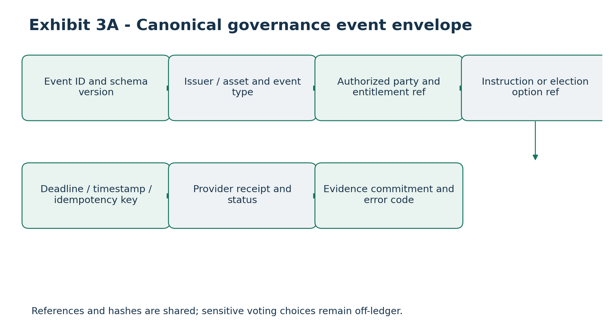
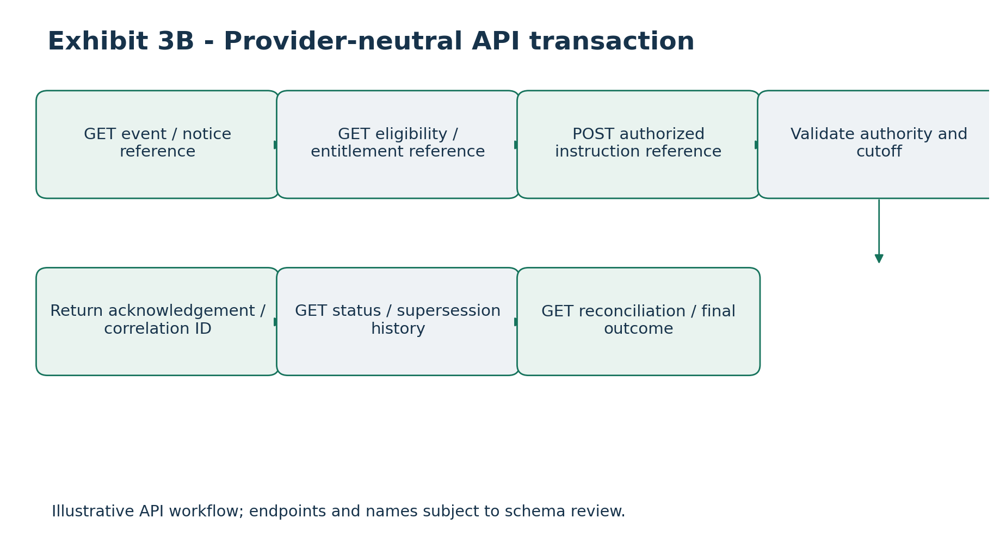

# Table of Contents

# ATTACHMENT 3

# Canonical Data and API Specifications

TOKEN PATH LLC \| CANTON FOUNDATION DEVELOPMENT FUND PROPOSAL Project: Canton Open Tax-Lot Interoperability and Proof-of-Basis Infrastructure Version: 1.0 - Proposed Technical Specification Development period: 24 weeks Integration: Canton/Daml, Oracle Coordination Layer, provider-neutral calculation services

Status: Proposed application-level API standard for Foundation review. These endpoints and schemas are not represented as existing Canton protocol standards or deployed production services. Exact implementation details require Milestone 1 validation.

# 1. Executive technical specification

The API framework establishes a standardized exchange of economic and tax information between Canton applications, oracle coordinators and authorized institutional calculation providers. It normalizes asset, account, tax-lot and economic-event data; supports acquisition, disposition, cost-basis adjustment, corporate-action and dividend workflows; preserves fractional-lot precision and calculation lineage; generates verifiable Proof-of-Basis attestations; and supports provider-independent integration, secure access and reconciliation.

The public reference implementation must function without proprietary Netbasis technology. Netbasis is an optional institutional reference adapter, not a mandatory dependency.

# 1.1 Interface architecture

1\. Canton tokenized asset application creates an authorized Daml oracle request. 2. Canton Ledger API connector observes the authorized request. 3. Token Path Oracle Coordinator validates and normalizes it. 4. Canonical API gateway routes to Netbasis, the open mock provider, or another qualified provider. 5. Provider returns a canonical calculation response. 6. Evidence service generates or verifies a signed Proof-of-Basis commitment. 7. An authorized Daml response is submitted and reconciled.

The gateway does not independently determine tax treatment. It standardizes how providers receive requests and return results.

# 2. API conventions and interoperability requirements

Property Proposed requirement

API protocol HTTPS REST with JSON API version /v1 Schema standard JSON Schema Draft 2020-12 OpenAPI OpenAPI 3.1 Authentication OAuth 2.0 client credentials or mutual TLS, depending on deployment Authorization Institution, tenant, service identity and operation Financial precision Decimal strings; never binary floating point Dates ISO 8601 calendar dates Timestamps RFC 3339 with explicit offset, normalized to UTC Identifiers Opaque strings; UUIDs where appropriate Idempotency Required for state-changing requests Correlation Unique end-to-end request identifier Privacy Confidential taxpayer data excluded from shared ledger records Compatibility Explicit versioning and controlled deprecation

2.1 Standard request headers POST /v1/calculations/basis-adjustments HTTP/1.1 Authorization: Bearer \<access_token\> Content-Type: application/json Accept: application/json X-Correlation-ID: corr-20261014-001 Idempotency-Key: adj-20261014-001 X-API-Version: 1.0

The same idempotency key and payload must return the previous logical outcome. Reusing the key with a different payload must return a conflict.

2.2 Standard response envelope { "request_id": "req-000184", "correlation_id": "corr-20261014-001", "status": "completed", "schema_version": "1.0.0", "provider_id": "provider-reference-01",

"calculation_id": "calc-000184", "calculation_version": "1.0.0", "completed_at": "2026-10-14T20:15:00Z", "result": {}, "evidence_id": "pob-000184" }

Supported statuses: accepted, processing, completed, rejected, failed. A completed response must include a result or an authorized result reference.

# 3. Canonical economic-data model

# 3.1 Asset master

Field Type Description

asset_id string Opaque canonical security identifier

asset_type enum Equity, fixed income, fund, digital asset, other

security_identifiers object Authorized ISIN, CUSIP or other identifiers

token_reference string Application-specific token reference

issuer_id string Issuer reference

currency string ISO 4217 currency

quantity_precision integer Fractional quantity scale

network_id string Canton deployment context

corporate_action_eligible boolean Lifecycle adjustment support

{ "asset_id": "asset-us-equity-001", "asset_type": "equity", "security_identifiers": {"isin": "US0000000001"}, "token_reference": "token-ref-001", "issuer_id": "issuer-001", "currency": "USD", "quantity_precision": 8, "network_id": "canton-reference", "corporate_action_eligible": true }

All identifiers are illustrative test fixtures, not actual securities or production Canton identifiers.

3.2 Account and ownership references { "account_ref": "acct-opaque-123", "institution_id": "custodian-001", "owner_ref": "owner-token-456", "tax_jurisdiction": "US", "account_type": "taxable", "ledger_party_ref": "party-reference-001" }

A caller-provided ledger_party_ref does not establish authorization. The integration must resolve it against authenticated Canton party information.

3.3 Canonical tax-lot record { "lot_id": "lot-001", "asset_id": "asset-us-equity-001", "account_ref": "acct-opaque-123", "acquisition_date": "2026-09-01", "original_quantity": "125.50000000", "remaining_quantity": "100.25000000", "original_basis": {"amount": "12550.00", "currency": "USD"}, "adjusted_basis": {"amount": "10125.25", "currency": "USD"}, "basis_method": "specific_identification", "holding_period_start": "2026-09-01", "status": "open", "version": 3, "last_adjustment_id": "adj-001" }

Convention: original basis represents the full acquired lot; adjusted basis represents the remaining open quantity. Original and remaining quantities are separately recorded. A provider must document any exceptions to this convention.

# 3.4 Money and quantity representation {"amount": "10250.125000", "currency": "USD"}

Quantities are decimal strings, for example "0.00012500". Providers must reject unsupported precision rather than silently round authoritative amounts.

# 4. Calculation APIs

Endpoint Method Purpose

/v1/tax-lots POST Canonical tax-lot creation

Endpoint Method Purpose

request

/v1/tax-lots/{lot_id} GET Authorized lot retrieval

POST Disposition calculation

/v1/calculations/ dispositions

POST Basis adjustment

/v1/calculations/basis- adjustments

POST Corporate-action effects

/v1/corporate-actions/ process

/v1/dividends/classify POST Dividend classification

/v1/attestations POST Proof-of-Basis creation

GET Authorized evidence metadata

/v1/attestations/ {attestation_id}

/v1/attestations/verify POST Attestation verification

/v1/reconciliations POST Initiate reconciliation

GET Reconciliation status

/v1/reconciliations/ {reconciliation_id}

/v1/requests/{request_id} GET Async request status

# 4.1 Tax-lot creation

## POST /v1/tax-lots

{ "event_id": "evt-acq-001", "asset_id": "asset-us-equity-001", "account_ref": "acct-opaque-123", "trade_date": "2026-10-01", "settlement_date": "2026-10-02", "quantity": "100.00000000", "gross_amount": {"amount": "10000.00", "currency": "USD"}, "capitalized_fees": {"amount": "10.00", "currency": "USD"}, "basis_method": "specific_identification" }

Illustrative response:

{ "request_id": "req-acq-001", "status": "completed", "lot_id": "lot-new-001",

"original_quantity": "100.00000000", "remaining_quantity": "100.00000000", "adjusted_basis": {"amount": "10010.00", "currency": "USD"}, "evidence_id": "pob-acq-001" }

# 4.2 Partial disposition and lot selection

## POST /v1/calculations/dispositions

{ "event_id": "evt-sale-001", "account_ref": "acct-opaque-123", "asset_id": "asset-us-equity-001", "trade_date": "2026-10-10", "quantity": "25.25000000", "net_proceeds": {"amount": "3030.00", "currency": "USD"}, "lot_selection": { "method": "specific_identification", "lots": \[{ "lot_id": "lot-001", "quantity": "25.25000000", "expected_version": 3 }\] } }

Provider must validate ownership, available quantity, currency and version. The following is a separate illustrative response fixture, not a calculated result of the preceding sample lot:

{ "calculation_id": "calc-sale-001", "status": "completed", "disposed_quantity": "25.25000000", "allocated_basis": {"amount": "2550.00", "currency": "USD"}, "net_proceeds": {"amount": "3030.00", "currency": "USD"}, "realized_gain_loss": {"amount": "480.00", "currency": "USD"}, "remaining_lot_quantity": "75.00000000", "evidence_id": "pob-sale-001" }

Executable fixtures must reconcile inputs and outputs exactly.

# 4.3 Cost-basis adjustment

## POST /v1/calculations/basis-adjustments

{ "event_id": "evt-adjust-001", "lot_id": "lot-001", "expected_version": 3, "adjustment_type": "wash_sale", "effective_date": "2026-10-10", "adjustment_amount": {"amount": "125.50", "currency": "USD"}, "supporting_event_refs": \["evt-sale-001", "evt-replacement-001"\], "calculation_policy_id": "us-tax-policy-reference" }

The provider determines whether the adjustment is permissible under applicable rules; a submitted amount cannot force a legally invalid basis change. Responses must include prior basis, adjustment, resulting basis, lot version and evidence reference.

# 5. Corporate-action APIs

## POST /v1/corporate-actions/process

Supported reference event types: stock_split, reverse_split, merger, spin_off, return_of_capital, cash_in_lieu, other_reorganization.

{ "corporate_action_id": "ca-001", "event_type": "stock_split", "asset_id": "asset-us-equity-001", "effective_date": "2026-10-12", "ratio": {"numerator": "2", "denominator": "1"}, "affected_lots": \[{"lot_id": "lot-001", "expected_version": 3}\] }

For a conventional two-for-one split, the reference fixture doubles quantity and preserves aggregate basis. More complex reorganizations require provider-specific allocation inputs. Every response must retain the event, calculation version, resulting lot references and Proof-of- Basis evidence.

# 6. Dividend and income APIs

## POST /v1/dividends/classify

{ "dividend_event_id": "div-001", "asset_id": "asset-us-equity-001", "account_ref": "acct-opaque-123",

"ex_date": "2026-09-28", "record_date": "2026-09-29", "payment_date": "2026-10-10", "gross_amount": {"amount": "500.00", "currency": "USD"}, "reported_classification": "ordinary_dividend", "classification_version": 1 }

# 6.1 Dividend reclassification

The interface must preserve original event ID, previous and new classification versions, effective correction date, changes in classified amounts, any related basis adjustments and superseded attestation references.

{ "dividend_event_id": "div-001", "supersedes_version": 1, "classification_version": 2, "classification_components": \[ {"type": "ordinary_dividend", "amount": "350.00"}, {"type": "return_of_capital", "amount": "150.00"} \], "currency": "USD", "reclassification_date": "2026-10-14" }

The classified components must reconcile to the original distribution unless the gross distribution itself is corrected. Return-of-capital treatment may require a corresponding basis adjustment, as determined by the provider.

# 7. Proof-of-Basis API

# 7.1 Attestation creation

## POST /v1/attestations

{ "schema_version": "1.0.0", "attestation_id": "pob-001", "asset_id": "asset-us-equity-001", "lot_ref": "lot-001", "event_ref": "evt-adjust-001", "calculation_id": "calc-adjust-001", "provider_id": "provider-reference-01", "calculation_version": "1.0.0",

"input_commitment": { "algorithm": "SHA-256", "digest": "\<hex-encoded-input-digest\>" }, "output_commitment": { "algorithm": "SHA-256", "digest": "\<hex-encoded-output-digest\>" }, "attested_at": "2026-10-14T20:15:00Z", "signing_key_id": "key-2026-01" }

Canonicalize the payload before signing, excluding the signature itself. The signed envelope identifies signature algorithm, signing key and signature value.

# 7.2 Attestation verification

## POST /v1/attestations/verify

{ "attestation_id": "pob-001", "expected_event_ref": "evt-adjust-001", "expected_asset_id": "asset-us-equity-001", "verify_signature": true, "verify_commitments": true }

{ "attestation_id": "pob-001", "signature_valid": true, "provider_authorized": true, "event_match": true, "commitment_match": true, "attestation_status": "active", "verified_at": "2026-10-14T20:16:00Z" }

Commitment verification requires access to the authorized canonical data or an appropriate cryptographic proof. Hash-only verifiers must report verification as unavailable rather than successful.

# 8. Canton event and Daml interoperability

Proposed Daml template Application-level event API interaction

TaxOracleRequest tax_oracle.requested Calculation submission

Proposed Daml template Application-level event API interaction

TaxOracleResponse tax_oracle.responded Result acknowledgment

TaxLotReference tax_lot.reference_created Tax-lot retrieval

BasisAdjustmentReference basis.adjusted Basis adjustment

CorporateActionNotice corporate_action.published Corporate-action processing

DividendEventNotice dividend.published Dividend classification

ProofOfBasisAttestation proof_of_basis.issued Evidence verification

Exception handling

ReconciliationException reconciliation.exception_op ened

These are proposed Token Path application conventions, not native Canton event types.

8.1 Canonical event envelope { "event_id": "evt-000001", "event_type": "basis.adjusted", "schema_version": "1.0.0", "network_id": "canton-reference", "ledger_event_ref": "opaque-ledger-event-reference", "occurred_at": "2026-10-14T20:15:00Z", "initiating_party_ref": "party-reference-001", "correlation_id": "corr-000001", "payload_ref": "payload-000001" }

The connector derives authoritative ledger event and party references from authenticated Canton responses, not from caller-supplied values.

# 9. Reconciliation and exception APIs

## POST /v1/reconciliations

{ "reconciliation_id": "rec-001", "account_ref": "acct-opaque-123", "asset_id": "asset-us-equity-001", "from_date": "2026-10-01", "to_date": "2026-10-14", "scope": \["tax_lots", "basis_adjustments", "corporate_actions", "dividends"\] }

The result identifies matched records, unmatched events, missing evidence, duplicates and version conflicts.

Code Meaning Handling

UNAUTHORIZED_PARTY Insufficient authority Reject; security audit

UNKNOWN_ASSET Asset missing Reject or request mapping

UNKNOWN_LOT Lot missing Exception queue

INSUFFICIENT_QUANTITY Quantity exceeds eligible lot Reject

LOT_VERSION_CONFLICT Stale lot version Refresh; controlled retry

DUPLICATE_REQUEST Repeated operation Return prior outcome

IDEMPOTENCY_CONFLICT Same key, changed payload Reject

PROVIDER_TIMEOUT Provider unavailable Bounded retry

INVALID_ATTESTATION Evidence verification failed Reject; escalate

Unsupported version Reject; identify supported versions

SCHEMA_VERSION_UNSUP PORTED

Records do not reconcile Exception review

RECONCILIATION_MISMAT CH

PRECISION_EXCEEDED Unsupported precision Reject

# 10. Security, authorization and privacy

Every endpoint enforces service authentication and operation-specific authorization. The reference design requires transport encryption, tenant isolation, scope-limited credentials, authenticated provider identity, strict validation, financial-data minimization, replay protection, rate limits, confidential-data-safe audit logs and cryptographically protected evidence.

Sensitive taxpayer identifiers and full account histories must not be exposed in shared Canton contracts by default. Supporting details are retrieved through separately authorized off-ledger access.

# 11. Reliability, versioning and operational behavior

# 11.1 Asynchronous processing

Long-running calculations may return HTTP 202 Accepted and a status resource:

{ "request_id": "req-async-001", "status": "accepted",

"status_url": "/v1/requests/req-async-001" }

# 11.2 Idempotency and concurrency

All state-changing operations require an idempotency key. Lot updates include an expected version or equivalent concurrency mechanism. Outdated versions must never silently overwrite newer records.

# 11.3 Schema evolution

Backward-compatible additions may occur within a major API version. Breaking changes require a new major version and migration policy. Unknown tax-classification enumerations must not be silently mapped to known values.

# 11.4 Audit retention

Retention depends on institutional requirements, applicable law and deployment agreement. The framework supports configurable retention and evidence supersession without silent historical modification.

# 12. Deterministic test fixtures and acceptance criteria

Test Expected outcome

Initial acquisition Valid initial tax-lot reference Partial disposition Quantity and basis allocation reconcile Fractional disposition Exact decimal reconciliation Two-for-one split Quantity doubles; aggregate basis preserved Dividend reclassification Supersession and revised classification Return of capital Traceable adjustment where applicable Duplicate request No duplicate accepted result Stale lot version Explicit concurrency rejection Invalid signature Attestation rejected Unauthorized party Rejection without data disclosure Provider timeout Retry or controlled exception Interrupted processing Durable recovery and reconciliation

All published fixtures must contain internally consistent inputs and expected outputs, enforced by machine-executable assertions.

# 13. Milestone delivery schedule

Deliverable Target Evidence

Week 20 Test and review reports

Canonical data dictionary Week 4 Versioned specification Draft OpenAPI 3.1 Week 4 Published API contract JSON Schemas Week 4 Validation tests Acquisition/disposition APIs Week 10 End-to-end tests Basis adjustment APIs Week 10 Deterministic fixtures Proof-of-Basis APIs Week 10 Signature verification tests Corporate-action APIs Week 16 Lifecycle scenarios Dividend APIs Week 16 Reclassification tests Reconciliation APIs Week 16 Recovery and exception tests Security and resilience validation

External adapter interoperability

Week 24 Independent integration evidence

# 14. Open technical decisions

1\. Canton/Daml SDK and Ledger API compatibility versions. 2. Signature algorithm and canonicalization profile. 3. Tax-lot ownership and concurrency model. 4. Provider identity registration and revocation. 5. Precision and rounding policies. 6. Multi-currency calculation conventions. 7. Evidence retention and authorized disclosure. 8. Rate limits and performance targets. 9. Corporate-action classification taxonomy. 10. External adopter-specific integration requirements.

# 15. Conclusion

Attachment 3 specifies a provider-neutral API framework for Canton applications to request and verify institutional economic-data calculations. It separates public interoperability infrastructure from proprietary tax engines while supporting adjusted cost basis, fractional tax lots, corporate actions, dividends, Proof-of-Basis attestations and reconciliation.

Implementation status: Detailed proposed specification for initial Foundation review. Machine-readable OpenAPI files, JSON Schemas and executable fixtures are identified as future milestone deliverables and are not claimed as completed here.

# Governance and Voluntary Corporate-Action Election Extension

Alignment with Attachment 1: provider-neutral proxy voting and voluntary corporate-action election reference workflows, planned within the existing 24-week, 1,900,000 CC funding envelope.

## Canonical governance and election event extensions

Versioned, provider-neutral schemas shall distinguish proxy voting from voluntary corporate-action elections. Proposed entities include ProxyMeetingNotice, VotingEntitlementReference, VotingInstructionReference, VotingInstructionStatus, CorporateActionElectionNotice, ElectionOption, ElectionInstructionReference, ElectionAcknowledgment and ElectionOutcomeReference. Names are proposed canonical schema identifiers, not claims that deployed Canton templates already exist.

## Required field conventions

| **Entity**                    | **Required fields / references**                                                      | **Privacy and validation**                      |
|-------------------------------|---------------------------------------------------------------------------------------|-------------------------------------------------|
| ProxyMeetingNotice            | eventId, issuerRef, securityRef, recordDate, meetingDate, materialsRef, schemaVersion | No personal holder data in public reference     |
| VotingEntitlementReference    | entitlementRef, eventId, positionRef, eligibilityAsOf, authorityRef                   | Beneficial entitlement verified off-ledger      |
| VotingInstructionReference    | instructionId, eventId, entitlementRef, optionRefs, submittedAt, idempotencyKey       | Authorized instruction only; private selections |
| VotingInstructionStatus       | instructionId, status, agentRef, receiptRef, statusAt                                 | Accepted does not mean counted                  |
| CorporateActionElectionNotice | eventId, securityRef, eventType, optionSet, deadlines, version                        | Timezone and cutoff semantics explicit          |
| ElectionInstructionReference  | instructionId, eventId, optionId, eligiblePositionRef, requestedQuantity              | Validated against event rules                   |
| ElectionOutcomeReference      | eventId, instructionId, agentRef, finalStatus, allocationRef                          | No inferred final allocation                    |

## Proposed API operations

POST /v1/governance/proxy-instructions and GET /v1/governance/proxy-instructions/{id}; GET /v1/governance/meetings/{id}; GET /v1/corporate-actions/elections/{id}; POST /v1/corporate-actions/election-instructions; GET /v1/corporate-actions/election-instructions/{id}. These are proposed interface paths for specification, not currently available endpoints. Every mutation requires authentication, authorization, idempotency and signed evidence references.

## Validation and failure codes

Required validations include record-date entitlement, permitted actor role, security/event match, option compatibility, fractional or omnibus restrictions, timestamp and cutoff timezone, duplicate submissions, revoked/modified instructions and event-version mismatch. Proposed errors include ENTITLEMENT_UNVERIFIED, CUTOFF_EXPIRED, OPTION_NOT_ALLOWED, INSTRUCTION_DUPLICATE, AGENT_REJECTED and OUTCOME_PENDING.

## Implementation and regulatory boundary

The governance and election workflows are proposed provider-neutral reference capabilities. They do not constitute a production proxy tabulator, voting agent, transfer agent, custodian or corporate-action election agent. Authorized intermediaries remain responsible for legal entitlement, cutoffs, instruction execution and final outcomes. Mock demonstrations do not imply live partner integration.

# Recreated and Updated Visual Exhibits

The following proposed reference diagrams extend the source architecture and supporting exhibits to include proxy voting and voluntary corporate-action elections. Existing source exhibits and tables remain in the document.

## Exhibit 3A - Canonical governance event envelope

References and hashes are shared; sensitive voting choices remain off-ledger.

## Exhibit 3B - Provider-neutral API transaction

Illustrative API workflow; endpoints and names subject to schema review.
