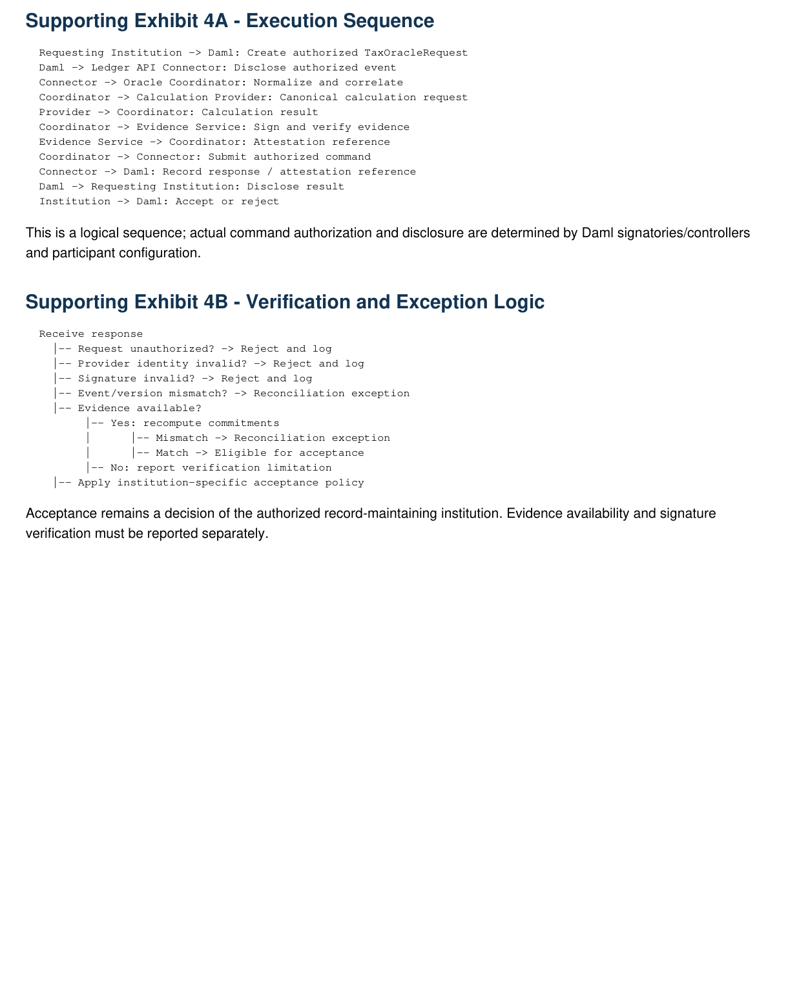
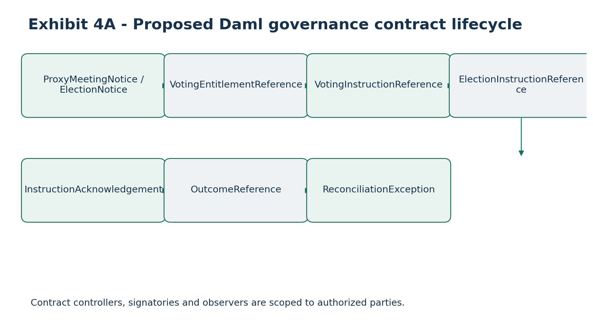
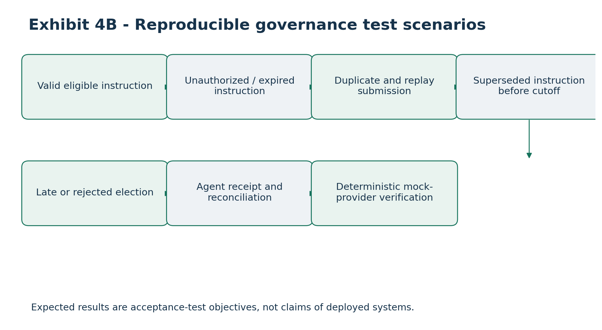

# Daml Smart Contracts, Oracle Integration and Verification Test Plan

### Canton Open Tax-Lot Interoperability and Proof-of-Basis Infrastructure

Applicant: Token Path LLC \| Duration: 24 weeks

Version: 1.0 - Proposed Technical Specification

Classification: Canton Foundation Development Fund - Technical Attachment

This is a proposed implementation and verification specification. Daml examples are illustrative design sketches, not compiled production contracts. Independent audits, external integrations and performance measurements remain milestone deliverables.

# 1. Executive Technical Overview

Token Path proposes a Canton-native Daml framework allowing authorized institutions to request, receive, verify and reconcile institutional tax-lot and economic-data calculations for tokenized securities. Daml coordinates permissions and evidence references; calculation engines remain off-ledger.

• Reusable Daml templates and choice authorization

• Ledger API integration with durable checkpoints

• Provider-neutral oracle coordination and signed Proof-of-Basis evidence

• Corporate-action, dividend and fractional-lot workflows

• Security, privacy, exception handling and automated tests

Netbasis is an optional institutional reference integration. A public deterministic mock provider will run independently without proprietary Netbasis algorithms, credentials or licensed data. The project does not modify Canton consensus, sequencing or settlement protocols.

# 2. Technical Objectives and Scope

### 2.1 Objectives

• Authorized execution: only permitted parties initiate, process, accept or supersede results.

• Provider neutrality: contracts never require a proprietary calculation provider.

• Provenance: accepted results link to source, version, event and verifiable commitment.

• Privacy: confidential tax and investor records remain off-ledger.

• Resilience: replay, retries and failures produce deterministic auditable outcomes.

• Independent verification: signatures, authorization and evidence can be tested.

### 2.2 Public deliverables

Daml templates and choice logic; authorization policies; Ledger API connector; canonical event mappings; oracle validation; attestation references; exception and reconciliation workflows; automated tests; deployment instructions; example integrations and developer documentation.

# 3. Proposed Daml Contract Architecture

Logical contract Purpose Principal authority

TaxOracleRequest Authorized calculation request Requesting institution

TaxOracleResponse Authenticated calculation response Authorized response issuer

TaxLotReference Institutional lot reference Record-maintaining institution

BasisAdjustmentReference Accepted/proposed adjustment Record-maintaining institution

CorporateActionNotice Authorized event publication Event publisher

DividendEventNotice Dividend and reclassification Event publisher

ProofOfBasisAttestation Signed evidence reference Attestation issuer

ReconciliationException Discrepancy lifecycle Exception owner

Template names are proposed application primitives, not Canton-native protocol types. The implementation may consolidate templates or use Daml interfaces where beneficial.

# 4. Daml Authorization Model

### 4.1 Rules

• Controllers may exercise only their authorized choices; signatories and observers must reflect actual business consent and disclosure.

• Oracle operators do not receive unrestricted control of custodial tax-lot records.

• Calculation providers may produce results but may not unilaterally accept changes to institutional records.

• Auditors require explicit disclosure; infrastructure administrators receive no automatic Daml party rights.

• Off-ledger API approval or a caller-provided party identifier does not establish Canton authorization.

### 4.2 Contract authorization matrix

Template Signatory Observer Controller

TaxOracleRequest Requester Oracle operator Oracle: process; requester: cancel

TaxOracleResponse Response issuer Requester, oracle Requester: accept/reject

TaxLotReference Record institution Authorized recipient Record institution: supersede

BasisAdjustmentReference Record institution Authorized recipient Record institution: accept

CorporateActionNotice Event publisher Authorized subscribers Publisher: correct

DividendEventNotice Event publisher Authorized subscribers Publisher: reclassify

ProofOfBasisAttestation Attestation issuer Authorized verifier Issuer: revoke; verifier: acknowledge

ReconciliationException Exception owner Operational parties Owner: resolve/escalate

The final contract design must validate creation authority for follow-on contracts and explicit multi-party authorization. Token movement does not itself establish tax-basis succession.

# 5. Daml Data Types and Economic References

Proposed opaque types: AssetRef, AccountRef, TaxLotRef, EconomicEventRef, OracleRequestRef, CalculationRef, AttestationRef, ProviderRef, EvidenceRef and SchemaVersion. Lot-reference contracts include asset, lot, institution, version, event, evidence commitment, verification locator and status. Confidential records remain in authorized provider systems.

Decimal semantics and explicit scale validation are required. Unsupported precision must fail explicitly; binary floating point is prohibited for authoritative calculations.

# 6. Illustrative Daml Contract Design

The following sketches show intended permission boundaries; they are not asserted to compile or to implement complete business validation.

### 6.1 TaxOracleRequest

template TaxOracleRequest with requester : Party oracleOperator : Party requestId : Text assetRef : Text eventRef : Text calculationType : Text payloadCommitment : Text schemaVersion : Text where signatory requester observer oracleOperator

choice CancelRequest : () controller requester do pure ()

choice AcceptForProcessing : ContractId OracleWorkItem controller oracleOperator do create OracleWorkItem with requester; oracleOperator; requestId; assetRef eventRef; calculationType; payloadCommitment schemaVersion

OracleWorkItem must be separately defined with signatory consent and creation authority consistent with the exercising parties. Validation and state transitions are omitted here.

### 6.2 TaxOracleResponse

Response fields: response/request IDs, provider, calculation version, result commitment, evidence locator, attestation reference, status and timestamp. Confidential calculations remain off-ledger unless explicitly authorized.

### 6.3 ProofOfBasisAttestation

template ProofOfBasisAttestation with issuer : Party verifier : Party attestationId : Text requestId : Text assetRef : Text eventRef : Text evidenceCommitment : Text signingKeyId : Text schemaVersion : Text where signatory issuer observer verifier

nonconsuming choice AcknowledgeAttestation : () controller verifier do pure ()

Acknowledgment does not itself verify the external signature. Cryptographic verification is performed by an authorized evidence service unless a separately reviewed on-ledger mechanism is implemented.

# 7. Contract Lifecycle and State Management

### 7.1 Request lifecycle

Created -\> Authorized -\> Accepted for processing -\> Processing -\> Completed / Rejected / Failed / Cancelled. These are logical states; Daml may represent changes through contract creation and archival.

### 7.2 Result and lot lifecycle

Results progress through submitted, validated, accepted, rejected, superseded or revoked. Tax-lot references are maintained by the responsible institution, with versioned changes and concurrency checks.

### 7.3 Corrections

Corporate-action corrections and dividend reclassifications must preserve prior event IDs, versions, reasons, new evidence commitments and the authorized acceptance decision. No silent historical overwrite is permitted.

# 8. Canton Ledger API Integration

• Authenticate to supported participant Ledger API; subscribe only to events visible to authorized parties.

• Maintain durable checkpoints and stable correlation identifiers.

• Normalize contract creation/archival events and route requests to the coordinator.

• Submit responses with valid Canton party authorization.

• Distinguish prepared, submitted/unknown, accepted, rejected and reconciled commands.

• Reconcile uncertain completions before retrying to avoid duplicate accepted results.

The connector must tolerate restart, replay, provider retry, duplicated ledger delivery and command submission timeout without unintended duplicate economic-data records.

# 9. Oracle Coordinator and Provider Integration

The coordinator implements Attachment 3 APIs: authorize, validate schema, route by tenant, normalize inputs, enforce idempotency, validate results, generate or verify evidence, and submit permitted Canton responses.

### 9.1 Interchangeable adapters

A deterministic open mock provider must operate independently. Netbasis may serve as an optional institutional adapter. Switching providers where methodology affects tax treatment requires appropriate institutional approval.

### 9.2 Failure handling

• Configurable timeouts and bounded backoff

• Circuit breaking or equivalent provider protection

• Permanent error classification and exception queue

• Durable status records and reconciliation after recovery

# 10. Proof-of-Basis Verification

The signed manifest includes attestation/schema IDs, asset/event references, provider and methodology versions, input/output commitments, timestamp, key ID, signature, evidence locator and supersession status.

Stage Verification

## 1. Structure Validate schema and required fields

## 2. Identity Bind key to authorized provider

## 3. Signature Verify canonical signed payload

## 4. Association Match expected asset and economic event

## 5. Commitments Recompute when authorized source data is available

## 6. Status Check revocation and supersession

## 7. Access Confirm verifier entitlement

A valid signature proves attribution and integrity, not correctness under tax law, beneficial ownership, market-data accuracy or regulatory approval. If evidence is unavailable, the verification result must state that limitation.

# 11. Corporate Actions, Dividends and Fractional Lots

### 11.1 Corporate actions

Reference workflows include stock splits, reverse splits, mergers, spin-offs, return of capital and cash in lieu. Daml manages authorized event references; detailed tax treatment is computed by the provider.

### 11.2 Dividends

Classification and reclassification workflows retain original event, revised classification, superseded evidence and any linked basis adjustments.

### 11.3 Fractional lots

Tests cover partial-lot disposal, fractional quantity, allocated basis, remaining quantity, explicit rounding and versioned adjustments.

### 11.4 Wash sales

The public workflow demonstrates provider-returned wash-sale adjustments without embedding a proprietary wash-sale engine. It retains methodology version, affected lots and evidence.

# 12. Testing Strategy

Layer Required validation

Unit Templates, choices, states, IDs, versioning, input validation

Authorization Unauthorized controllers, privacy and visibility denial

Integration Daml -\> Ledger API -\> coordinator -\> provider -\> evidence -\> Daml

Compatibility Event IDs, statuses, decimals, schema versions, errors

Security Invalid signatures, replay, revoked keys, cross-tenant access

Resilience Restarts, timeouts, duplicate events, database outage

Performance Throughput, latency, recovery, exception backlog

Numerical throughput and recovery targets will be set during Milestone 1 using representative workloads; no unverified production performance guarantees are asserted.

# 13. Detailed Test Case Matrix

ID Scenario Expected outcome

DAML-001 Authorized request creation Created

DAML-002 Unauthorized request processing Rejected

DAML-003 Authorized cancellation Lifecycle updated

DAML-004 Unauthorized cancellation Rejected

DAML-005 Valid response submission Accepted

DAML-006 Invalid response issuer Rejected

DAML-007 Institution accepts adjustment Reference created

DAML-008 Provider modifies institution lot Rejected

DAML-009 Attestation acknowledgment Recorded

DAML-010 Unauthorized supersession Rejected

API-001 Acquisition Lot result

API-002 Partial disposition Basis reconciles

API-003 Fractional disposition Precision preserved

API-004 Stale version Conflict

API-005 Duplicate key / same payload Prior result

API-006 Duplicate key / changed payload Conflict

CA-001 Two-for-one split Quantity doubles; basis preserved

CA-002 Reverse split Reconciles

CA-003 Action correction Prior version traceable

DIV-001 Initial classification Recorded

DIV-002 Reclassification Superseding version

DIV-003 Return of capital Basis linkage

POB-001 Valid attestation Signature valid

POB-002 Altered payload Invalid

POB-003 Revoked signing key Policy-based status

ID Scenario Expected outcome

POB-004 Wrong event reference Invalid

POB-005 Missing evidence Limitation reported

RES-001 Provider timeout Retry / exception

RES-002 Connector restart Recovery

RES-003 Duplicate ledger event No duplicate accepted result

RES-004 Unknown command completion Reconciled

RES-005 Evidence-store interruption Controlled failure

SEC-001 Cross-tenant request Denied

SEC-002 Unauthorized evidence retrieval Denied and logged

SEC-003 Malformed request Validation error

SEC-004 Unauthorized party visibility No disclosure

Each executable case will specify prerequisites, input fixture, execution steps, expected output and reviewable evidence artifact.

# 14. Deterministic Economic Test Fixtures

Fixture Input Expected result

Acquisition 100 shares; \$10,000 gross; \$10 capitalized fees Basis \$10,010; \$100.10/share

Partial disposition 100 shares / \$10,010 basis; sell 25 for \$3,000 Allocated basis \$2,502.50; gain \$497.50; 75 shares / \$7,507.50 remaining

Two-for-one split 75 shares; \$7,507.50 basis 150 shares; \$7,507.50 total; \$50.05/share

Dividend reclassification \$500 original; \$350 ordinary; \$150 return of capital

Components total \$500; prior evidence superseded; basis change per provider rules

Fixtures will publish input JSON, expected output JSON, assumptions, decimal policy, evidence references and automated reconciliation assertions. Simplified examples are not comprehensive tax-law determinations.

# 15. Test Environments

### 15.1 Local developer environment

Document supported Daml tooling, package compilation, unit tests, mock provider, coordinator startup and reproducible workflow execution.

### 15.2 Canton integration environment

Validate party authorization, contract disclosure, Ledger API subscriptions, command submission, replay recovery and multi-party behavior.

### 15.3 Independent integration environment

Provide published APIs and test harnesses for external Canton participants. Two independent integrations or pilots are targeted for final milestone evidence, not asserted as existing.

# 16. Continuous Integration and Quality Assurance

• Daml compile and unit/authorization tests

• JSON Schema/OpenAPI and mock-provider tests

• End-to-end integration tests

• Dependency scanning and static analysis where supported

• License review and reproducible build checks

Mandatory correctness and security checks must pass before release-branch merge. Test results will be retained as reviewable build artifacts.

# 17. Independent Security Assessment

Milestone 4 assessment scope: Daml authorization, disclosure privacy, oracle authentication, provider identity, signing and key management, API authorization, replay controls, evidence storage, deployment configuration and recovery. Findings will be severity-rated; critical and high issues affecting supported flows require remediation or documented acceptance under the agreed standard before final release.

# 18. Milestones and Acceptance Criteria

Milestone Deliverables Acceptance evidence

M1 / Weeks 1-4 Architecture; authorization; schemas; initial Daml project; threat model; repository

Reviewed model; compiling initial package/prototype; tests; reproducible setup

M2 / Weeks 5-10 Ledger connector; durable coordinator; provider API; acquisition/disposition; Proof-of-Basis

End-to-end demonstration; signing tests; replay and duplicate tests

M3 / Weeks 11-16 Corporate actions; dividends; fractional lots; reconciliation and exceptions

Passing lifecycle fixtures; correction lineage; reconciliation reports

M4 / Weeks 17-20 Independent security review; remediation; deployment; recovery benchmarks Security report; remediation and recovery evidence

M5 / Weeks 21-24 Two independent integrations/pilots; tagged release; documentation; 12-month plan

External acceptance evidence; public release and passing suite

# 19. Open-Source and Intellectual Property Boundaries

Apache-2.0 is proposed, subject to legal and dependency review. Public deliverables include Daml source, provider-neutral APIs, connector/coordinator, evidence utilities, mock provider, fixtures, deployment examples and documentation. Existing Netbasis algorithms, historical data, customer records and proprietary services remain excluded. The public workflow must operate without Netbasis dependencies.

# 20. Engineering Governance and Change Control

• Version-controlled code and architecture decision records

• Peer review, issue tracking and vulnerability disclosure

• Release procedures, changelogs and compatibility tests

• Migration paths for breaking changes

• Named maintainers and a twelve-month support plan

# 21. Project Risks and Mitigations

Risk Mitigation

Authorization complexity Executable negative tests early

Canton interface changes Version-pinned environment

Duplicate oracle results Durable idempotency and reconciliation

Confidential data leakage Off-ledger records and least privilege

Provider lock-in Public mock provider and API

Precision inconsistencies Decimal validation and fixtures

Corporate-action complexity Provider-specific rules behind shared interface

Signing key compromise Managed keys, rotation, revocation

Adoption delays Early ecosystem engagement and test harness

Maintenance uncertainty Named maintainers and twelve-month plan

# 22. Final Acceptance Standard

• Daml package compiles in the documented environment and authorization tests pass.

• Public oracle works without Netbasis proprietary dependencies.

• Acquisition, disposition, adjustment, corporate-action and dividend fixtures pass.

• Signatures and evidence references are independently verifiable.

• Durable event processing, exception handling and reconciliation are demonstrated.

• Independent security assessment and remediation evidence are provided.

• Two independently verifiable integrations or pilots are demonstrated.

• Public source, deployment documentation and maintenance plan are released.

# 23. Conclusion

The proposed Daml contracts coordinate authorization and economic-data references while off-ledger providers perform financial calculations. Signed Proof-of-Basis attestations preserve provenance without disclosing proprietary algorithms or confidential taxpayer information on Canton. The resulting public implementation is intended to be independently testable, provider-neutral and reusable across Canton tokenized-asset applications.

Status: Detailed proposed technical specification. Executable Daml, independent audits, external pilots and measured benchmarks remain future milestone deliverables.

# Supporting Exhibit 4A - Execution Sequence

Requesting Institution -\> Daml: Create authorized TaxOracleRequest Daml -\> Ledger API Connector: Disclose authorized event Connector -\> Oracle Coordinator: Normalize and correlate Coordinator -\> Calculation Provider: Canonical calculation request Provider -\> Coordinator: Calculation result Coordinator -\> Evidence Service: Sign and verify evidence Evidence Service -\> Coordinator: Attestation reference Coordinator -\> Connector: Submit authorized command Connector -\> Daml: Record response / attestation reference Daml -\> Requesting Institution: Disclose result Institution -\> Daml: Accept or reject

This is a logical sequence; actual command authorization and disclosure are determined by Daml signatories/controllers and participant configuration.

# Supporting Exhibit 4B - Verification and Exception Logic

Receive response \|-- Request unauthorized? -\> Reject and log \|-- Provider identity invalid? -\> Reject and log \|-- Signature invalid? -\> Reject and log \|-- Event/version mismatch? -\> Reconciliation exception \|-- Evidence available? \|-- Yes: recompute commitments \| \|-- Mismatch -\> Reconciliation exception \| \|-- Match -\> Eligible for acceptance \|-- No: report verification limitation \|-- Apply institution-specific acceptance policy

Acceptance remains a decision of the authorized record-maintaining institution. Evidence availability and signature verification must be reported separately.

# Governance and Voluntary Corporate-Action Election Extension

Alignment with Attachment 1: provider-neutral proxy voting and voluntary corporate-action election reference workflows, planned within the existing 24-week, 1,900,000 CC funding envelope.

## Daml governance and election reference contracts

Extend the proposed Daml design with ProxyMeetingNotice, VotingEntitlementReference, VotingInstructionReference, VotingInstructionStatus, VoluntaryElectionNotice, ElectionInstructionReference and ElectionOutcomeReference. Each is a reference/authorization template; it does not transfer tabulation or election-agent authority to the ledger. Use contract signatories, observers and controllers to restrict actions by institutional role.

## Authorization and lifecycle test matrix

| **Test**                              | **Expected behavior**                       | **Evidence**                                    |
|---------------------------------------|---------------------------------------------|-------------------------------------------------|
| Unauthorized vote instruction         | Reject before agent dispatch                | Daml authorization failure and audit event      |
| Missing record-date entitlement       | No actionable vote instruction              | Exception reference                             |
| Duplicate instruction idempotency key | Single agent submission                     | Replay log and correlation ID                   |
| Expired proxy cutoff                  | Reject or route for authorized review       | Timestamped rejection                           |
| Modified instruction                  | Allow only if permitted by agent rules      | Version chain and receipt                       |
| Election option invalid               | Reject before dispatch                      | Schema/option error                             |
| Election cutoff timezone boundary     | Deterministic accept/reject decision        | Clock fixture and rule version                  |
| Final election outcome                | Reconcile allocation and tax-lot references | Signed agent receipt and economic-data response |

## Reference integration and test plan

During Milestone 3 the public mock provider will simulate a proxy notice, a fractional entitlement, an instruction acknowledgment, a voluntary tender/exchange election and an amended instruction. Test fixtures will verify authorization, deadline, replay and reconciliation behavior. Live submissions remain out of scope absent an authorized external service and explicit approval.

## Milestone 3 acceptance extension

Independent reviewers can execute the reference voting and voluntary-election scenarios using a deterministic mock agent, demonstrate rejected unauthorized or late instructions, inspect signed status evidence and reconcile election outcomes with any subsequent basis-adjustment reference.

## Implementation and regulatory boundary

The governance and election workflows are proposed provider-neutral reference capabilities. They do not constitute a production proxy tabulator, voting agent, transfer agent, custodian or corporate-action election agent. Authorized intermediaries remain responsible for legal entitlement, cutoffs, instruction execution and final outcomes. Mock demonstrations do not imply live partner integration.

# Visual exhibits and architecture diagrams

## Exhibits 4A-4B - Execution and verification workflows

Exhibit from the source proposal, retained as a high-resolution image.

# Recreated and Updated Visual Exhibits

The following proposed reference diagrams extend the source architecture and supporting exhibits to include proxy voting and voluntary corporate-action elections. Existing source exhibits and tables remain in the document.

## Exhibit 4A - Proposed Daml governance contract lifecycle

Contract controllers, signatories and observers are scoped to authorized parties.

## Exhibit 4B - Reproducible governance test scenarios

Expected results are acceptance-test objectives, not claims of deployed systems.
