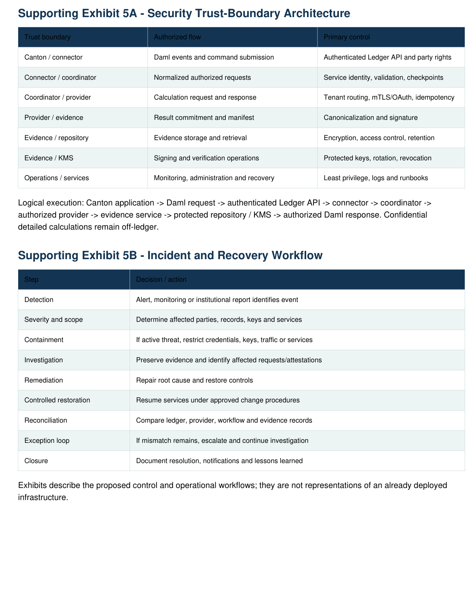
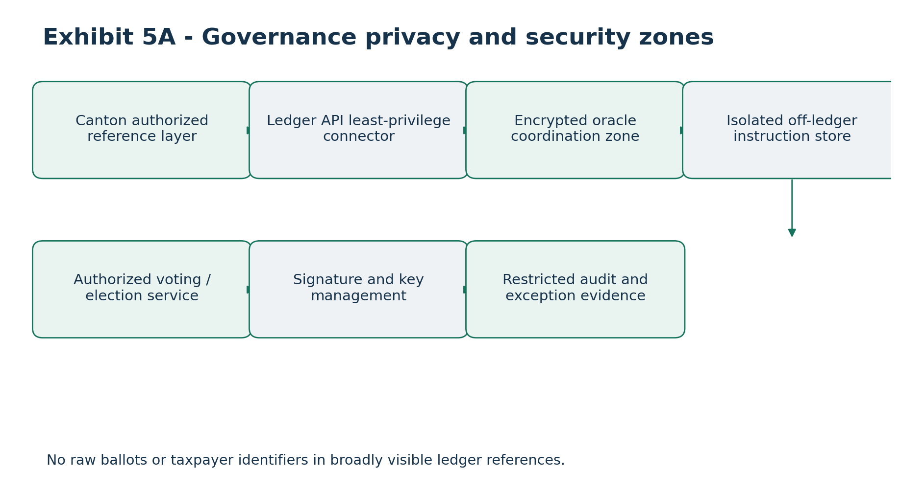
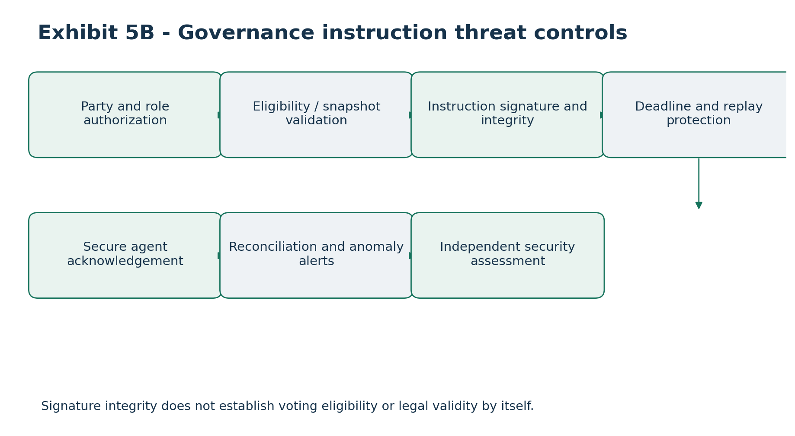

# Security, Privacy, Deployment and Operational Resilience Plan

### Canton Open Tax-Lot Interoperability and Proof-of-Basis Infrastructure

Applicant: Token Path LLC \| Project duration: 24 weeks

Document version: 1.0 - Proposed Security and Deployment Specification

Independent review target: Milestone 4, Weeks 17-20

This attachment defines proposed security and operational controls. It does not represent deployed, independently assessed, certified or production-validated infrastructure. The open-source reference framework is provider-neutral and operates independently of proprietary Netbasis systems.

## 1. Executive Security Overview

Token Path proposes secure, privacy-preserving oracle infrastructure connecting Canton tokenized-asset workflows to institutional tax-lot, adjusted cost-basis, corporate-action, dividend and economic-data calculation providers. Sensitive taxpayer records and proprietary algorithms remain off-ledger.

• Institutional confidentiality through off-ledger access controls

• Cryptographic provenance through signed Proof-of-Basis attestations

• Canton-native Daml authorization and controlled contract visibility

• Durable processing, retry and reconciliation

• Provider-neutral integrations

• Independent verification and external security review

Canton ledger authorization establishes permitted workflow actions; it does not independently establish substantive correctness of off-ledger tax calculations.

## 2. Security Objectives and Design Principles

### 2.1 Zero-trust service architecture

• Authenticate every inter-service connection; network proximity alone is not trust

• Enforce least privilege and tenant isolation

• Restrict network ingress and provider routing

• Protect secrets and signing keys

• Log security events and review privileged access

### 2.2 Privacy by design

Ledger contracts carry opaque references, status and evidence commitments rather than full investor identities, account histories or tax calculations. Confidential disclosure requires separate authorization.

### 2.3 Separation of duties

Distinguish the requesting institution, oracle operator, calculation provider, attestation issuer, institutional accepting party, verifier and infrastructure administrator. A single infrastructure role does not automatically inherit all privileges.

### 2.4 Secure defaults

Production-oriented examples default to restricted ingress, limited scopes, protected secrets, logging and explicit provider registration. Development-only shortcuts must be labeled and excluded from production guidance.

## 3. System Security Architecture

Domain Components Security responsibility

Canton participant Daml applications and Ledger API Party authorization, disclosure, command rights

Oracle integration Connector, coordinator, workflow database Authentication, idempotency, routing, checkpoints

Calculation providers Reference provider; optional Netbasis adapter Calculation accuracy, data protection, method version

Evidence and verification Signer, verifier, evidence store, KMS Signature integrity, access, rotation, revocation

Security operations Monitoring, backups, IAM, incident response Privileged access, resilience, security review

Logical trust boundaries may be deployed in separate institutional environments. The provider responsibility for economic correctness is distinct from the oracle framework's responsibility for transport, authorization and provenance.

## 4. Data Classification and Privacy Controls

Class Examples Controls

Public Open-source schemas and synthetic fixtures Integrity and version control

Internal Non-sensitive operational metadata Authenticated access

Confidential Institutional tax lots and calculation results Encryption and limited disclosure

Restricted Taxpayer identifiers, secrets, signing keys Strong access restrictions and specialized handling

### 4.2 Ledger minimization

The reference Daml contracts do not require names, Social Security numbers, tax identifiers, residential addresses, complete statements, full transaction histories or unrestricted beneficial-owner records.

### 4.3 Opaque identifiers and commitments

Opaque account, lot and event identifiers should not embed identifying data. Because unsalted hashes of predictable financial values can be guessed, commitment construction and evidence access must be assessed for confidentiality as well as integrity.

### 4.4 Retention, deletion and archival

Retention and permitted deletion depend on institutional policies, legal obligations, tax-record requirements and contractual terms. Off-ledger deletion procedures must address backups and archival. Ordinary deletion does not erase historical Canton ledger events.

## 5. Identity and Access Management

• Service identities: OAuth 2.0 client credentials, mTLS or compatible institutional federation as finalized in Milestone 1

• Authorize by tenant, institution, operation, asset/account scope and provider entitlement

• Independently enforce Daml party rights and API access policies

• Require named privileged identities, MFA where supported, and logged elevation

• Segregate credentials, workflows, evidence, key scopes and operational logs by tenant

• Reject and audit cross-tenant access

Caller-provided party identifiers are not sufficient proof of Canton authorization; the connector must use authenticated participant credentials and ledger responses.

## 6. Cryptographic Security and Key Management

### 6.1 Transport and storage

Use current TLS profiles for service communications, with mutual TLS where required by institutional deployments. Encrypt sensitive databases and evidence stores at rest. Prohibit obsolete protocols and insecure cipher configurations.

### 6.2 Proof-of-Basis signing

Canonicalized signed manifests include attestation ID, provider, calculation version, asset/event references, input/output commitments, timestamp, key ID and schema version. Algorithm, canonicalization, signature encoding and key format will be selected and documented during Milestone 1.

### 6.3 Key lifecycle

• Use managed KMS or hardware-backed key protection where appropriate

• Never embed private keys in code, images or ordinary logs

• Support planned and emergency rotation

• Associate each attestation with the signing key and validity interval

• Track revocation and historical verification policy

### 6.4 Compromised key response

Suspend signing; revoke or disable affected keys; identify impacted attestations; notify affected operators as required; supersede or reissue evidence where appropriate; investigate and restore under change control.

## 7. API and Application Security

• Validate JSON Schema, required fields, identifiers, decimals, dates, enumerations, payload size and versions

• Reject invalid or expired credentials and unauthorized operations

• Require durable idempotency keys for state-changing requests

• Use rate limits and bounded resource consumption

• Return actionable errors without leaking confidential data

• Maintain dependency inventory, scanning and remediation tracking

A retry with an existing idempotency key and a different payload must fail with an explicit conflict; repeated valid requests must not create duplicate accepted results.

## 8. Canton and Daml Security Controls

• Enforce signatory, observer and controller rules from Attachment 4

• Limit contract disclosure to authorized parties

• Submit commands only through properly authorized party identities

• Distinguish Canton contract authority from off-ledger calculation correctness

• Version Daml packages and document contract upgrades and migrations

An oracle operator cannot unilaterally rewrite a custodian's authoritative lot records. Evidence provenance, reconciliation and institutional acceptance provide additional off-ledger controls.

## 9. Infrastructure Deployment Plan

Zone Principal services Network policy

Canton connectivity Participant Ledger API access Authenticated restricted connector access

Oracle application Connector, coordinator, workers Private service-to-service paths

Provider integration Authorized calculation adapters Allowlisted outbound provider paths

Evidence and data Database, evidence store, KMS Restricted internal access and encryption

Operations Monitoring, backup, administration Named privileged access and audit

### 9.2 Cloud portability

Containerized services and version-controlled infrastructure definitions should remain portable across suitable institutional environments. Provider-specific cloud examples must describe equivalent capabilities.

### 9.3 Environment isolation

Separate development, staging and production; use synthetic public fixtures. Never copy production secrets or restricted investor records into open development environments. Infrastructure-as-code must not contain credentials.

## 10. Availability and Operational Resilience

### 10.1 Failure scenarios

• Oracle and connector restarts

• Network interruptions and delayed command completion

• Provider unavailability

• Repeated ledger events

• Evidence-store or workflow-database outages

• Schema incompatibility

• Partial workflow failure

### 10.2 Durable workflow state

Persist request/correlation IDs, idempotency keys, status, provider response, evidence issuance, command submission, completion confirmation and reconciliation results.

### 10.3 Delivery semantics

Treat event delivery as potentially at-least-once. Use durable idempotency, optimistic concurrency and reconciliation for effectively-once accepted outcomes rather than asserting distributed exactly-once delivery.

### 10.4 Recovery objectives

Set measured RTO/RPO and service-level targets in Milestone 1; no production uptime guarantee is claimed. Backup integrity and restore procedures must be exercised. Provider substitution must require appropriate institutional authorization when tax treatment may differ.

## 11. Reconciliation and Data Integrity

Reconcile Canton requests, coordinator state, provider responses, signed attestations, submitted commands and accepted institutional references.

Exception Response

Missing provider response Retry within policy; then queue exception

Duplicate or conflicting request Idempotency / version conflict

Invalid signature or missing evidence Reject or limit verification; escalate

Unknown lot / stale version Institutional review and refresh

Uncertain ledger completion Query and reconcile before resubmission

Calculation mismatch Create tracked reconciliation exception

Exception records include ID, references, severity, detection time, owner, status, remediation history and resolution evidence. Financial controls include quantity conservation, basis reconciliation, fractional precision, dividend totals and supersession lineage.

## 12. Monitoring, Logging and Observability

### 12.1 Operational metrics

• Request volumes, completion and rejection rates

• Provider and oracle latency

• Ledger command completion

• Retry counts and backlog

• Evidence verification failures

• Reconciliation mismatch counts

• Service availability and resource utilization

### 12.2 Security logs

Log authentication failures, denied access, administrative changes, provider registration, signing-key operations, attestation revocation and exception closure. Do not log taxpayer identifiers, private keys, tokens or full confidential payloads.

### 12.3 Alerts

Monitor sustained provider failures, connector disconnection, signature-failure spikes, unauthorized access, key-service failures, reconciliation backlog and storage degradation. Set thresholds using test baselines.

## 13. Threat Modeling

Threat Impact Mitigation

Unauthorized oracle request Improper processing/disclosure Daml + API authorization

Forged provider response Incorrect result accepted Provider identity and signatures

Replay or duplicate Repeated economic effect Durable idempotency

Signing-key compromise Fraudulent evidence Protected keys, rotation, revocation

Cross-tenant access Confidential-data leak Tenant isolation

Connector compromise Unauthorized commands Scoped party identities

Malicious payload Service compromise/outage Strict validation and limits

Provider outage Delayed calculation Retry, queue, reconcile

Data corruption Incorrect financial records Commitments and backups

Supply-chain compromise Malicious dependency Scanning and build controls

Cloud misconfiguration Unauthorized access Least privilege and config review

The initial threat model will use a structured method such as STRIDE and be updated as trust boundaries, deployments and dependencies are finalized.

## 14. Vulnerability Management

• Peer review and automated unit/integration/security tests

• Static analysis, secrets detection and dependency/container scanning

• Document findings with severity, owner, reproduction, remediation and verification

• Remediate critical and high-severity release blockers or address through formally approved exceptions

• Publish a coordinated security disclosure process

The public release pipeline must not silently waive mandatory security checks.

## 15. Independent Security Assessment

An external assessment is planned for Milestone 4 (Weeks 17-20). Scope includes Daml authorization and privacy, Ledger API connector, oracle/provider authentication, Proof-of-Basis signing, key management, API controls, replay protection, evidence storage, infrastructure configuration and recovery.

Expected outputs: scope, methodology, severity-rated findings, reproduction details, recommendations, residual risks and remediation verification. The assessor has not yet been selected or contracted. The project must not claim certification or audit completion before receiving evidence.

## 16. Incident Response Plan

Phase Action

## 1. Detect Monitoring, alerts, institution report or security testing

## 2. Classify Severity, affected services, data exposure and economic impact

## 3. Contain Disable affected keys, credentials, network paths or services

## 4. Investigate Preserve evidence, identify root cause and affected attestations

## 5. Remediate Repair controls, rotate credentials and correct vulnerabilities

## 6. Recover Restore under change control and reconcile economic records

## 7. Review Document findings, notifications and control improvements

Notification obligations depend on applicable law and institutional agreements. An attestation-integrity incident requires identification of impacted evidence and possible revocation, supersession or institutional revalidation.

## 17. Disaster Recovery and Business Continuity

• Document restoration of connector, coordinator, database, evidence store, signer/verifier and provider connectivity

• Encrypt and restrict backups; verify restoration

• Simulate database loss, evidence outage, connector disconnect, provider outage and KMS failure

• Support controlled suspension of new requests without silently discarding pending work

• Reconcile outstanding requests before declaring normal operation

Backup frequency, retention and measurable recovery objectives will be defined during engineering validation.

## 18. Performance and Capacity Management

Benchmark event ingestion, oracle throughput, provider latency, evidence signing/verification, reconciliation speed, recovery time and resource utilization. Load scenarios include bursts of corporate actions, dividend reclassifications, fractional-lot updates and concurrent institutions.

Capacity documentation will cover connector workers, workflow storage, evidence repositories, provider connections and monitoring. Targets will be defined in Milestone 1 and validated later; no unverified benchmarks are asserted.

## 19. Deployment and Release Management

• Source review, compilation and automated contract/API tests

• Security scanning and reproducible build artifacts

• Staged environment promotion with approval

• Documented service rollback and controlled Daml/data migrations

• Pinned dependencies, configuration templates, health checks and troubleshooting guides

Release guidance will identify production-required controls and clearly distinguish synthetic developer examples from hardened institutional deployments.

## 20. Operational Governance and Responsibilities

Function Proposed accountable role

Daml contract security Daml Technical Lead

Oracle security Backend Engineering Lead

Infrastructure configuration DevSecOps Lead

Signing keys Security Operations Owner

Calculation correctness Calculation Provider

Institutional acceptance Record-Maintaining Institution

Independent assessment External Security Assessor

Incident coordination Designated Incident Manager

Grant reporting Token Path Project Lead

These are proposed functions, not confirmed named appointments. Runbooks will cover startup/shutdown, credentials, provider onboarding, evidence verification, exceptions, restoration, escalation and releases. A twelve-month public maintenance plan is due at final milestone.

## 21. Milestone-Based Security Deliverables

Milestone Deliverables Acceptance evidence

M1: Weeks 1-4 Security baseline, data classification, trust boundaries, IAM, key design, threat model, deployment topology

Reviewed assumptions, high-priority risks and reference configuration

M2: Weeks 5-10 Authenticated APIs, connector permissions, signed evidence, idempotency, protected workflow state

Authentication, signature and replay tests; end-to-end demonstration

M3: Weeks 11-16 Exception processing, lifecycle reconciliation, audit logging and recovery tests

Exception audit trails, negative authorization and recovery evidence

M4: Weeks 17-20 Independent assessment, remediation, security guide, runbooks and benchmarks External report, remediation and recovery results

M5: Weeks 21-24 Security-reviewed public release, disclosure policy, 12-month plan and pilot evidence

Release test results, named maintainers and external verification

## 22. Security Acceptance Test Matrix

Test ID Scenario Expected result

SEC-001 Unauthorized API access Rejected

SEC-002 Unauthorized Daml choice Rejected

SEC-003 Cross-tenant evidence request Denied

SEC-004 Invalid provider credential Rejected

SEC-005 Altered attestation payload Invalid signature

SEC-006 Revoked signing key Policy-based failure/status

SEC-007 Duplicate calculation No duplicate accepted result

SEC-008 Replayed event Idempotent handling

SEC-009 Malformed decimal Validation error

SEC-010 Unsupported schema Compatibility error

SEC-011 Provider timeout Retry or exception

SEC-012 Connector restart Durable recovery

SEC-013 Workflow database restore State reconciled

SEC-014 Evidence store outage Controlled failure/recovery

SEC-015 Unauthorized admin action Denied and logged

SEC-016 Secret in repository Detected; build blocked

SEC-017 Vulnerable dependency Scan finding

SEC-018 Conflicting lot version Rejected

SEC-019 Reconciliation mismatch Exception created

SEC-020 Signing-key rotation New and historical verification

Each executable test must include prerequisites, test steps, expected results and inspectable evidence.

## 23. Security Risk Register

Risk Initial assessment Priority

Unauthorized contract access High Immediate

Signing-key compromise High Immediate

Confidential-data disclosure High Immediate

Forged calculation response High Immediate

Cross-tenant leakage High Immediate

Duplicate ledger processing Medium-High High

Provider outage Medium High

Evidence unavailability Medium High

API incompatibility Medium Medium

Dependency vulnerability Medium High

Operational misconfiguration Medium-High High

Delayed security assessment Medium High

Preliminary qualitative ratings only; formal likelihood, impact, control effectiveness and residual risk will be assessed during Milestone 1.

## 24. Open Security and Deployment Decisions

• Canton/Daml version and supported hosting model

• Signature profile and KMS provider

• Identity federation and network connectivity

• Evidence retention and authorized disclosure

• RTO, RPO and service-level objectives

• Independent security assessor

• Incident notification and on-call staffing

• Provider registration and revocation

• Tenant-isolation implementation

• External pilot security requirements

All decisions will be recorded in version-controlled security and architecture decision records.

## 25. Final Security Acceptance Standard

• Reference deployment reproducible from published instructions

• Authentication and Daml authorization tests passing

• No confidential investor data required in public contracts or fixtures

• Proof-of-Basis signing and verification documented and tested

• Replay/duplicate handling demonstrated

• Provider and connector outages recover safely

• Workflow state and evidence restored and reconciled

• Monitoring and audit logging demonstrated

• Independent assessment completed and material findings addressed

• External pilot security evidence available

• Twelve-month maintenance and disclosure process published

## 26. Conclusion

Token Path proposes an institutional-oriented security foundation for Canton economic-data interoperability combining Daml authorization, provider-neutral interfaces, signed Proof-of-Basis attestations, off-ledger privacy, durable processing, reconciliation and independent review. Open-source infrastructure remains distinct from proprietary Netbasis technology and confidential institutional records.

Document status: Proposed security and deployment specification. Security controls, audits, recovery measurements and production deployment remain milestone deliverables.

## Supporting Exhibit 5A - Security Trust-Boundary Architecture

Trust boundary Authorized flow Primary control

Canton / connector Daml events and command submission Authenticated Ledger API and party rights

Connector / coordinator Normalized authorized requests Service identity, validation, checkpoints

Coordinator / provider Calculation request and response Tenant routing, mTLS/OAuth, idempotency

Provider / evidence Result commitment and manifest Canonicalization and signature

Evidence / repository Evidence storage and retrieval Encryption, access control, retention

Evidence / KMS Signing and verification operations Protected keys, rotation, revocation

Operations / services Monitoring, administration and recovery Least privilege, logs and runbooks

Logical execution: Canton application -\> Daml request -\> authenticated Ledger API -\> connector -\> coordinator -\> authorized provider -\> evidence service -\> protected repository / KMS -\> authorized Daml response. Confidential detailed calculations remain off-ledger.

## Supporting Exhibit 5B - Incident and Recovery Workflow

Step Decision / action

Detection Alert, monitoring or institutional report identifies event

Severity and scope Determine affected parties, records, keys and services

Containment If active threat, restrict credentials, keys, traffic or services

Investigation Preserve evidence and identify affected requests/attestations

Remediation Repair root cause and restore controls

Controlled restoration Resume services under approved change procedures

Reconciliation Compare ledger, provider, workflow and evidence records

Exception loop If mismatch remains, escalate and continue investigation

Closure Document resolution, notifications and lessons learned

Exhibits describe the proposed control and operational workflows; they are not representations of an already deployed infrastructure.

# Governance and Voluntary Corporate-Action Election Extension

Alignment with Attachment 1: provider-neutral proxy voting and voluntary corporate-action election reference workflows, planned within the existing 24-week, 1,900,000 CC funding envelope.

## Governance and election security controls

The optional workflows introduce sensitive voting choices, beneficial ownership indicators, instruction authority, cutoff rules and external-agent acknowledgments. Threat modeling must address instruction spoofing, unauthorized disclosure, entitlement overstatement, duplicate submissions, replay, deadline manipulation, version substitution and fraudulent agent responses.

## Control matrix

| **Risk**                            | **Required mitigation**                                            | **Verification**              |
|-------------------------------------|--------------------------------------------------------------------|-------------------------------|
| Unauthorized voting instruction     | Role-based Daml authorization and external-agent entitlement check | Negative authorization tests  |
| Vote-choice confidentiality         | Off-ledger encrypted storage and scoped reference visibility       | Disclosure review             |
| Duplicate/replayed instruction      | Idempotency, signed nonce and durable correlation                  | Replay tests                  |
| Cutoff manipulation                 | Signed rule version, UTC timestamp and source timezone             | Boundary tests                |
| Untrusted acknowledgment            | Agent identity validation and signed receipt                       | Signature negative tests      |
| Omnibus or fractional misallocation | Intermediary-provided entitlement reference; no inferred rights    | Scenario-based reconciliation |
| Election status mismatch            | Exception queue, immutable evidence references                     | Recovery test                 |

## Operational boundaries and incident response

A successful cryptographic signature confirms message integrity and attributable origin only. The system must not imply that a vote has been tabulated or that a tender or election has been executed until the responsible agent confirms its status. Revocation, replacement and incident-response actions require the relevant agent and institution to authorize them.

## Security assessment scope

The independent review should include governance/election authorization paths, credential isolation, privacy leakage, cutoff and replay controls, instruction integrity and external-agent callback validation, in addition to existing tax-lot oracle controls.

## Implementation and regulatory boundary

The governance and election workflows are proposed provider-neutral reference capabilities. They do not constitute a production proxy tabulator, voting agent, transfer agent, custodian or corporate-action election agent. Authorized intermediaries remain responsible for legal entitlement, cutoffs, instruction execution and final outcomes. Mock demonstrations do not imply live partner integration.

# Visual exhibits and architecture diagrams

## Exhibits 5A-5B - Trust boundaries and incident recovery

Exhibit from the source proposal, retained as a high-resolution image.

# Recreated and Updated Visual Exhibits

The following proposed reference diagrams extend the source architecture and supporting exhibits to include proxy voting and voluntary corporate-action elections. Existing source exhibits and tables remain in the document.

## Exhibit 5A - Governance privacy and security zones

No raw ballots or taxpayer identifiers in broadly visible ledger references.

## Exhibit 5B - Governance instruction threat controls

Signature integrity does not establish voting eligibility or legal validity by itself.
