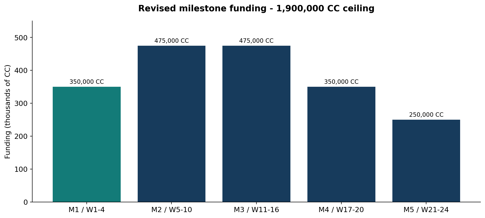
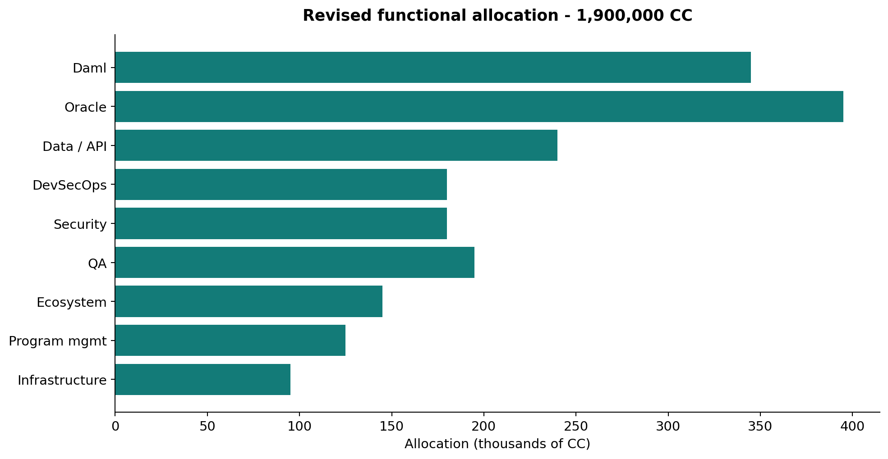
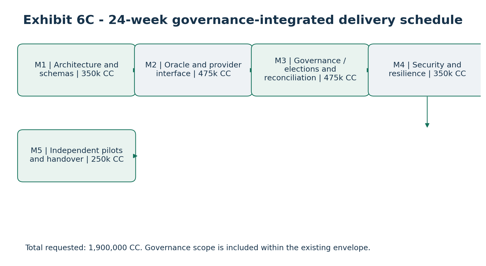
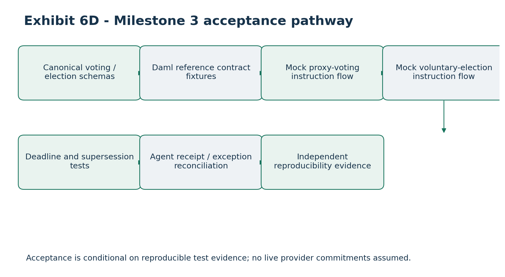

# Detailed Budget, Staffing Schedule and Milestone-Based Funding Justification

### Canton Open Tax-Lot Interoperability and Proof-of-Basis Infrastructure

Applicant: Token Path LLC \| Project period: 24 weeks

Funding request: Up to 1,900,000 CC

Version: 1.0 - Proposed Budget and Resource Allocation

Planning estimates only. Allocations are denominated in CC, not guaranteed USD purchasing power. Named staffing, vendor quotations, CC valuation, and Foundation payment terms remain subject to confirmation. Grant-funded deliverables are intended to be provider-neutral and independently usable without proprietary Netbasis services.

## 1. Executive Funding Overview

Token Path LLC proposes up to 1,900,000 CC over 24 weeks for a Canton-native open-source framework for tax-lot interoperability, economic-data processing and cryptographically verifiable Proof-of-Basis attestations. Five milestone tranches tie disbursement to inspectable public deliverables, security evidence and independent ecosystem integrations.

Grant-funded scope includes Daml contracts, Ledger API connectivity, provider-neutral oracle coordination, canonical schemas, a deterministic reference provider, attestation verification, reconciliation, deployment tooling, automated testing and public documentation. Proprietary Netbasis algorithms, customer data and unrelated commercial development are excluded.

## 2. Funding Request and Milestone Allocation

### Milestone Period Funding Share

M1: Architecture and reference foundation Weeks 1-4 350,000 CC 18.42%

M2: Core oracle and Proof-of-Basis Weeks 5-10 475,000 CC 25.00%

M3: Economic lifecycle and reconciliation Weeks 11-16 475,000 CC 25.00%

M4: Security, resilience and deployment Weeks 17-20 350,000 CC 18.42%

M5: Ecosystem integrations and release Weeks 21-24 250,000 CC 13.16%

TOTAL 24 weeks 1,900,000 CC 100%

Amounts are proposed funding ceilings, not automatic disbursements. Actual acceptance and payment will follow the Foundation-approved agreement.

## 3. Budget Development Methodology

• Organize spending by functional workstream, not assumed full-time staffing for every role

• Concentrate specialists in relevant milestones

• Require deliverable-based acceptance and source-level evidence

• Document personnel rates, time or deliverable records, vendor quotations and payment records

• Keep grant-funded activities separate from proprietary Netbasis development

### 3.1 Currency and valuation policy

CC funding is not assigned a fixed USD exchange rate. The executed budget must document USD cost estimates, CC-to-USD conversion method, valuation timing, volatility treatment, conversion records and material variance approvals. Proposed CC allocations do not guarantee specific fiat purchasing power.

## 4. Detailed Functional Budget

### Functional category Allocation Share

Canton/Daml smart-contract engineering 345,000 CC 18.16%

Oracle and backend integration engineering 395,000 CC 20.79%

Canonical data, financial logic and reference provider 240,000 CC 12.63%

DevSecOps, infrastructure and deployment 180,000 CC 9.47%

Independent security assessment and remediation 180,000 CC 9.47%

QA, automated testing and interoperability 195,000 CC 10.26%

Ecosystem integration and developer enablement 145,000 CC 7.63%

Technical program management and grant reporting 125,000 CC 6.58%

Infrastructure, tooling and contingency reserve 95,000 CC 5.00%

TOTAL 1,900,000 CC 100%

These allocations are provisional and require a final resource-loaded USD cost model, staffing commitments and vendor quotations.

## 5. Canton/Daml Smart Contract Engineering

Proposed allocation: 345,000 CC

### Scope

Develop TaxOracleRequest, TaxOracleResponse, TaxLotReference, BasisAdjustmentReference, CorporateActionNotice, DividendEventNotice, ProofOfBasisAttestation and ReconciliationException templates, authorization rules, lifecycle transitions and version compatibility.

### Deliverables

Compilable Daml package; authorization tests; documented interfaces; lifecycle examples; tagged source artifacts.

### Staffing / execution

Senior Canton/Daml technical lead with additional engineering support as required.

### Funding justification

Standardized reusable on-ledger authorization and reference workflows.

## 6. Oracle and Backend Integration Engineering

Proposed allocation: 395,000 CC

### Scope

Implement Ledger API connector, event subscriptions, coordinator, authenticated provider routing, durable workflow state, idempotency, retries, asynchronous command submission, evidence integration and exception handling.

### Deliverables

Connector; coordinator; provider adapter framework; replay and recovery tests; operational documentation.

### Staffing / execution

Backend/oracle lead and integration engineers.

### Funding justification

A common provider-neutral integration layer prevents duplicated bespoke connectivity.

## 7. Canonical Data, Financial Logic and Reference Provider

Proposed allocation: 240,000 CC

### Scope

Implement asset, lot, acquisition, disposition, adjustment, corporate-action, dividend, attestation and reconciliation schemas with exact decimal rules and synthetic fixtures.

### Deliverables

OpenAPI and JSON Schemas; independent deterministic mock provider; test fixtures; compatibility checks.

### Staffing / execution

Financial-data domain specialist and API engineer.

### Funding justification

The public system must run without proprietary Netbasis credentials or algorithms.

## 8. DevSecOps, Infrastructure and Deployment

Proposed allocation: 180,000 CC

### Scope

Implement containers, CI/CD, secrets and service identity, environment isolation, monitoring, backup/recovery, deployment automation and performance instrumentation.

### Deliverables

Reference deployment; infrastructure-as-code examples; build pipeline; security checklist; runbooks.

### Staffing / execution

DevSecOps engineering support throughout the project.

### Funding justification

Independent ecosystem teams need reproducible, secure deployment guidance.

## 9. Independent Security Assessment and Remediation

Proposed allocation: 180,000 CC

### Scope

Commission independent review of Daml authorization, contract privacy, provider identity, APIs, evidence signing, key management, replay controls, workflow recovery and deployment.

### Deliverables

Independent report; ranked findings; remediation tracking; verification evidence.

### Staffing / execution

Independent assessor concentrated in weeks 17-20 with final follow-up.

### Funding justification

Independent review is a condition of responsible public infrastructure release; amount is not a vendor quote.

## 10. Quality Assurance, Automated Testing and Interoperability

Proposed allocation: 195,000 CC

### Scope

Build contract, negative authorization, API, fractional-lot, corporate-action, dividend, attestation, replay, resilience, performance and release regression tests.

### Deliverables

Automated test suite; deterministic fixtures; benchmark and integration reports.

### Staffing / execution

QA/automation engineering with domain reviewers.

### Funding justification

Correctness and reproducibility must be independently demonstrated.

## 11. Ecosystem Integration and Developer Enablement

Proposed allocation: 145,000 CC

### Scope

Support onboarding, sample adapters, technical documentation, independent integrations, public demonstrations and adopter feedback.

### Deliverables

Developer guides; example integration; two externally verifiable pilots or integrations; feedback report.

### Staffing / execution

Integration/developer enablement lead, primarily later milestones.

### Funding justification

Demonstrate adoption outside Token Path; no partner commitment is assumed.

## 12. Technical Program Management and Grant Reporting

Proposed allocation: 125,000 CC

### Scope

Coordinate milestones, engineering dependencies, vendor procurement, risk register, budget monitoring, Foundation reporting and acceptance evidence.

### Deliverables

Schedules; technical status; budget-to-actual; risk register; acceptance log; final report.

### Staffing / execution

Technical project manager throughout all five milestones.

### Funding justification

Supports accountable execution and Foundation oversight.

## 13. Infrastructure, Tooling and Contingency Reserve

Proposed allocation: 95,000 CC

### Scope

Provide controlled development/testing compute, build services, storage, security tools, networking and approved unexpected integration needs.

### Deliverables

Usage records; approvals; documented technical justification; reported expenditures.

### Staffing / execution

Project lead approval subject to grant rules.

### Funding justification

Reserve is restricted to eligible costs and not unrestricted discretionary funding.

## 14. Proposed Staffing Structure

### Role Responsibility Peak involvement

Canton/Daml Technical Lead Contract design, authorization Weeks 1-16

Backend/Oracle Engineering Lead Connector and coordinator Weeks 1-20

Integration Engineer Provider APIs and event processing Weeks 5-24

Financial Data/API Engineer Schemas and reference calculations Weeks 1-16

DevSecOps Engineer Deployment, security and recovery Weeks 1-24

QA/Automation Engineer Fixtures and integration tests Weeks 5-24

Independent Security Assessor External security review Weeks 17-20

Ecosystem Integration Lead External adoption and pilots Weeks 11-24

Technical Program Manager Reporting and milestone control Weeks 1-24

These are proposed roles, not named appointments. A person may perform compatible functions, but independent assessment must remain sufficiently independent. Confirm contracts, rates, availability and accountability before execution.

## 15. Proposed Staffing Schedule

### Role W1-4 W5-10 W11-16 W17-20 W21-24

Daml lead High High High Medium Low

Oracle lead Medium High High High Medium

Integration engineer Low High High Medium High

Financial data/API High High High Medium Low

DevSecOps Medium Medium Medium High High

QA/automation Low High High High High

Independent assessor - - Prep High Follow-up

Ecosystem lead Low Medium Medium Medium High

Program manager Medium Medium Medium Medium Medium

High/Medium/Low describe relative involvement, not contractual full-time equivalents. A resource-loaded plan with hourly/day rates and staffing availability remains to be finalized.

## 16. Milestone 1 - Architecture and Reference Foundation

Period: Weeks 1-4 Funding: 350,000 CC

### Deliverables

Reviewed Daml architecture; authorization matrix; canonical schemas; initial OpenAPI; mock-provider plan; repository; threat model; IP separation register; named technical lead.

### Workstream CC allocation

Daml engineering 95,000

Oracle/backend 75,000

Data/API 65,000

DevSecOps 35,000

Security assessment 0

QA/testing 25,000

Ecosystem enablement 10,000

Program management 30,000

Infrastructure/reserve 15,000

TOTAL 350,000

### Acceptance conditions

Foundation can inspect the public repo, reproduce initial reference setup and verify independence from proprietary Netbasis.

## 17. Milestone 2 - Core Oracle and Proof-of-Basis

Period: Weeks 5-10 Funding: 475,000 CC

### Deliverables

Ledger API connector; coordinator; provider-neutral APIs; acquisition/disposition; basis adjustments; signed manifests; attestation verification; replay tests.

### Workstream CC allocation

Daml engineering 115,000

Oracle/backend 140,000

Data/API 75,000

DevSecOps 40,000

Security assessment 0

QA/testing 55,000

Ecosystem enablement 15,000

### Workstream CC allocation

Program management 25,000

Infrastructure/reserve 10,000

TOTAL 475,000

### Acceptance conditions

End-to-end demonstration using public reference provider; verified attestation; target two ecosystem expressions of interest, not presumed signed commitments.

## 18. Milestone 3 - Economic Lifecycle and Reconciliation

Period: Weeks 11-16 Funding: 475,000 CC

### Deliverables

Corporate actions; dividends and reclassification; fractional lots; reconciliation; exception workflows; deterministic lifecycle fixtures.

### Workstream CC allocation

Daml engineering 95,000

Oracle/backend 125,000

Data/API 85,000

DevSecOps 25,000

Security assessment 0

QA/testing 70,000

Ecosystem enablement 35,000

Program management 30,000

Infrastructure/reserve 10,000

TOTAL 475,000

### Acceptance conditions

Passing lifecycle tests, traceable adjustments, precision checks and reconciliation evidence.

## 19. Milestone 4 - Security, Resilience and Deployment

Period: Weeks 17-20 Funding: 350,000 CC

### Deliverables

Independent security assessment; remediation; reproducible deployment; runbooks; recovery tests; benchmarks; updated threat model.

### Workstream CC allocation

Daml engineering 30,000

Oracle/backend 40,000

Data/API 10,000

DevSecOps 55,000

Security assessment 160,000

QA/testing 20,000

Ecosystem enablement 5,000

Program management 15,000

Infrastructure/reserve 15,000

TOTAL 350,000

### Acceptance conditions

Independent findings report, material remediation, deployment instructions and recovery demonstration.

## 20. Milestone 5 - Ecosystem Integrations and Public Release

Period: Weeks 21-24 Funding: 250,000 CC

### Deliverables

Two independently verifiable external integrations or pilots; public tagged release; API/Daml docs; onboarding; disclosure policy; final report; twelve-month plan.

### Workstream CC allocation

Daml engineering 10,000

Oracle/backend 15,000

Data/API 5,000

DevSecOps 25,000

Security assessment 20,000

QA/testing 25,000

Ecosystem enablement 80,000

Program management 25,000

Infrastructure/reserve 45,000

TOTAL 250,000

### Acceptance conditions

External integration evidence, published artifacts, final acceptance and budget reporting.

## 21. Consolidated Budget Reconciliation

The functional budget reconciles exactly to the five milestone ceilings. All amounts below are CC.

### Workstream M1 M2 M3 M4 M5 Total

Daml engineering 60k 90k 80k 30k 10k 270k 95k 115k 95k 30k 10k 345k

Oracle/backend 45k 105k 95k 40k 15k 300k 75k 140k 125k 40k 15k 395k

Data/API 45k 60k 60k 10k 5k 180k 65k 75k 85k 10k 5k 240k

DevSecOps 25k 30k 25k 45k 25k 150k 35k 40k 25k 55k 25k 180k

Security assessment 0k 0k 0k 130k 20k 150k 0k 0k 0k 160k 20k 180k

QA/testing 15k 45k 55k 15k 20k 150k 25k 55k 70k 20k 25k 195k

Ecosystem enablement 10k 15k 25k 5k 65k 120k 10k 15k 35k 5k 80k 145k

Program management 20k 20k 25k 15k 25k 105k 30k 25k 30k 15k 25k 125k

Infrastructure/reserve 5k 10k 10k 10k 40k 75k 15k 10k 10k 15k 45k 95k

TOTAL 350k 475k 475k 350k 250k 1,900k

The 1,900k CC total equals 1,900,000 CC. Functional allocations reconcile to the five revised milestone ceilings; amounts remain proposed pending a resource-loaded cost model.

## 22. Financial Reporting and Cost Controls

• Maintain approved budget, actual spend, commitments, balance and milestone mapping

• Support labor with engagement agreements, rates, time/deliverable records, invoices and payments

• Procure material vendors using defined scope, deliverables and documented pricing

• Segregate grant costs from proprietary Netbasis development and unrelated operations

• Document shared-resource allocation methodology

• Report financial and technical progress at each milestone

• Seek required approval for material reallocations

## 23. Funding Disbursement and Acceptance Framework

For each milestone, Token Path proposes to submit a deliverable inventory, repository references, demonstrations, tests, security evidence, budget-to-actual report, unresolved issues and an acceptance request. The Foundation controls acceptance and payment according to executed terms; a milestone date alone does not trigger automatic payment.

## 24. Cost Eligibility and Exclusions

### Eligible proposed uses

• Open Daml contracts and Ledger API integration

• Public oracle and canonical APIs

• Independent reference provider and synthetic fixtures

• Security audit and testing

• Reproducible deployment and developer documentation

• Independent ecosystem integration support

### Excluded proposed uses

• Proprietary Netbasis algorithm development and licensed historical data

• Confidential customer-specific implementations

• Unrelated commercial marketing or overhead

• Proprietary licensing that prevents independent use

• Unapproved executive distributions and unrelated business costs

Shared staff or infrastructure must be charged to the grant only under a documented reasonable allocation methodology.

## 25. Financial and Execution Risks

### Risk Potential impact Mitigation

CC price volatility USD purchasing power Agreed valuation/conversion policy

Engineering overrun Budget pressure Milestone controls and change approval

Specialist delay Schedule slippage Confirm lead and vendor availability early

Audit price variance Insufficient audit reserve Obtain scoped quotations

Partner delays Pilot acceptance risk Early outreach and public test harness

Infrastructure cost growth Budget pressure Usage limits and monitoring

Scope expansion Delivery delay Formal change control

IP overlap Open-source release risk IP register and counsel review

## 26. Financial Contingency and Scope Management

The 75,000 CC tooling/infrastructure/reserve category is controlled, not a discretionary allowance. Any material change requires documented technical justification, eligibility check, project approval and any Foundation consent required. If costs exceed approved funding, reprioritize noncritical work, reduce avoidable expenses or request an approved scope change. No additional funding is assumed.

## 27. Post-Grant Maintenance and Sustainability

Milestone 5 will deliver a twelve-month maintenance plan covering named maintainers, security response, dependency updates, compatibility, issue triage, community contributions and releases. The plan must distinguish committed resources from anticipated commercial or ecosystem support. No continuing Foundation funding is assumed.

## 28. Foundation Value and Funding Justification

• Reusable Daml authorization and economic-data contracts

• Provider-neutral oracle infrastructure rather than vendor lock-in

• Public schemas for tax lots, basis, corporate actions and dividends

• Verifiable Proof-of-Basis provenance

• Privacy-preserving off-ledger design

• Public tests and independent security evidence

• Developer onboarding and externally verifiable adoption

The funding case rests on reusable network-wide tooling, not a private tax-calculation platform.

## 29. Final Financial Acceptance Standard

• All functional and milestone allocations reconcile to approved totals

• Expenditures supported by auditable records

• Material variances and reallocations documented

• Grant work segregated from proprietary activities

• Public artifacts map to funded workstreams

• Audit and pilots supported by evidence

• Final budget and balances reconciled

• Open-source release and maintenance plan published

• All grant contractual conditions addressed

## 30. Conclusion

The proposed 1,900,000 CC budget allocates funding across five verifiable milestones over 24 weeks, emphasizing reusable Daml contracts, provider-neutral oracle APIs, economic-data schemas, cryptographic provenance, independent review and external adoption. The objective is a transparent funding model for independently inspectable public infrastructure, not subsidization of proprietary Netbasis software.

Status: Planning budget only. Staffing rates, vendor quotations, USD equivalents, CC valuation and grant terms require confirmation.

## Supporting Exhibit 6A - Milestone Funding Distribution

### Milestone Period CC Percent

M1 Weeks 1-4 350,000 18.42%

M2 Weeks 5-10 475,000 25.00%

M3 Weeks 11-16 475,000 25.00%

M4 Weeks 17-20 350,000 18.42%

M5 Weeks 21-24 250,000 13.16%

Funding peaks in Milestones 2 and 3 for core engineering and economic-lifecycle integration; Milestone 4 concentrates independent security and resilience validation.

## Supporting Exhibit 6B - Functional Budget Distribution

### Category CC Percent

Canton/Daml smart-contract engineering 345,000 18.16%

Oracle and backend integration engineering 395,000 20.79%

Canonical data, financial logic and reference provider 240,000 12.63%

DevSecOps, infrastructure and deployment 180,000 9.47%

Independent security assessment and remediation 180,000 9.47%

QA, automated testing and interoperability 195,000 10.26%

Ecosystem integration and developer enablement 145,000 7.63%

Technical program management and grant reporting 125,000 6.58%

Infrastructure, tooling and contingency reserve 95,000 5.00%

Both exhibits are based on proposed CC planning allocations, not a fixed fiat valuation.

| Milestone | Weeks | Revised CC | Share  |
|-----------|-------|------------|--------|
| M1        | 1-4   | 350,000    | 18.42% |
| M2        | 5-10  | 475,000    | 25.00% |
| M3        | 11-16 | 475,000    | 25.00% |
| M4        | 17-20 | 350,000    | 18.42% |
| M5        | 21-24 | 250,000    | 13.16% |
| TOTAL     | 24    | 1,900,000  | 100%   |

# Revised milestone and functional funding charts

## Exhibit 6A - Revised milestone funding distribution

Illustrative exhibit reproduced from the corresponding original proposal PDF; financial graphics use the revised funding schedule.

## Exhibit 6B - Revised functional budget distribution

Exhibit from the source proposal, retained as a high-resolution image.

# Governance and Voluntary Corporate-Action Election Extension

Alignment with Attachment 1: provider-neutral proxy voting and voluntary corporate-action election reference workflows, planned within the existing 24-week, 1,900,000 CC funding envelope.

## Governance and election scope within the approved envelope

The proposed proxy-voting and voluntary corporate-action election reference extension is incorporated within the existing 1,900,000 CC ceiling and 24-week schedule, principally under Milestone 3. No incremental grant request or independently verified cost estimate is implied. Functional workstream allocations are planning assumptions to be validated against staffing commitments and vendor quotations before contracting.

## Governance deliverables by milestone

| **Milestone**    | **Governance / election deliverables**                                | **Funding (unchanged)** |
|------------------|-----------------------------------------------------------------------|-------------------------|
| M1 - Weeks 1-4   | Reference schemas, role and privacy model, event/cutoff assumptions   | 350,000 CC              |
| M2 - Weeks 5-10  | Reusable authorization, evidence, adapter and idempotency services    | 475,000 CC              |
| M3 - Weeks 11-16 | Mock proxy and voluntary-election workflows; reconciliation tests     | 475,000 CC              |
| M4 - Weeks 17-20 | Independent security review of instruction and agent trust boundaries | 350,000 CC              |
| M5 - Weeks 21-24 | Developer guidance and optional pilot evaluation                      | 250,000 CC              |
| Total            | Conditional five-stage funding request                                | 1,900,000 CC            |

## Budget controls and dependency management

Engineering time for governance/election schemas, mock acknowledgments, deadline tests and documentation must be accounted for within the existing functional categories. Work that would require operating a regulated voting or election service, paid external tabulation, bespoke issuer integration or commercial production deployment is not funded by this reference scope without a separately approved change.

## Funding evidence

M3 acceptance evidence must include a reproducible mock voting instruction and a voluntary election instruction, authorization failure tests, cutoff handling and outcome-to-basis reconciliation. The 350,000 CC M1 authorization and 1,550,000 CC remaining conditional tranches remain unchanged.

## Implementation and regulatory boundary

The governance and election workflows are proposed provider-neutral reference capabilities. They do not constitute a production proxy tabulator, voting agent, transfer agent, custodian or corporate-action election agent. Authorized intermediaries remain responsible for legal entitlement, cutoffs, instruction execution and final outcomes. Mock demonstrations do not imply live partner integration.

# Recreated and Updated Visual Exhibits

The following proposed reference diagrams extend the source architecture and supporting exhibits to include proxy voting and voluntary corporate-action elections. Existing source exhibits and tables remain in the document.

## Exhibit 6C - 24-week governance-integrated delivery schedule

Total requested: 1,900,000 CC. Governance scope is included within the existing envelope.

## Exhibit 6D - Milestone 3 acceptance pathway

Acceptance is conditional on reproducible test evidence; no live provider commitments assumed.
