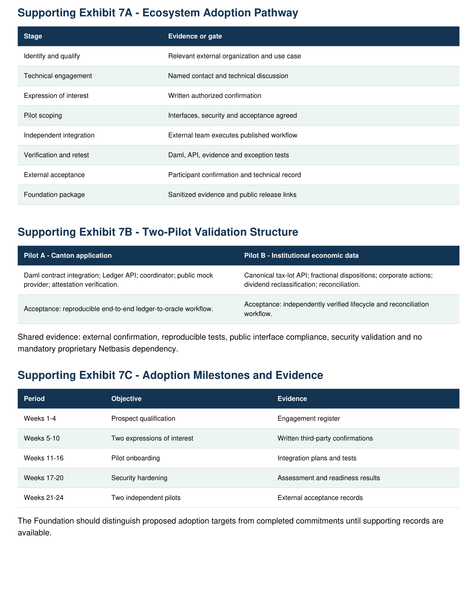
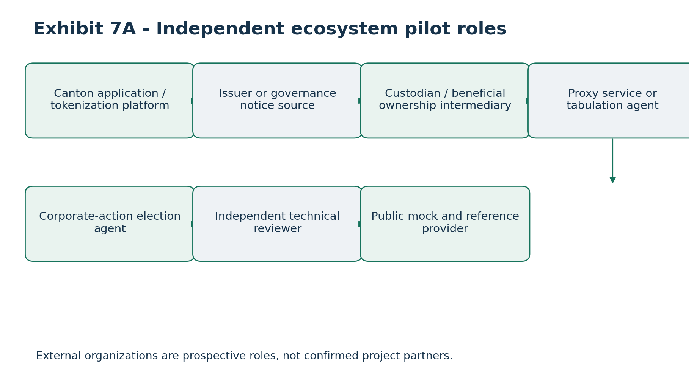
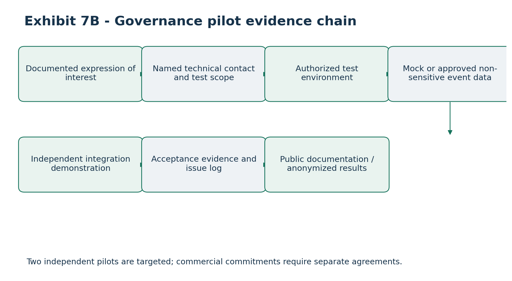

# Ecosystem Adoption, Independent Integration Commitments and Pilot Validation Plan

### Canton Open Tax-Lot Interoperability and Proof-of-Basis Infrastructure

Applicant: Token Path LLC \| Duration: 24 weeks

Grant request: Up to 1,900,000 CC \| Ecosystem allocation: 120,000 CC

Version: 1.0 - Proposed Ecosystem Adoption and Validation Plan

Partner references are engagement targets, not endorsements or signed commitments. Expressions of interest and two independent external pilots are proposed future deliverables. The open reference workflow must function without proprietary Netbasis services.

## 1. Executive Overview

Token Path proposes a Canton-native, provider-neutral open-source infrastructure framework enabling authorized tax-lot and economic-data requests, off-ledger calculations, signed Proof-of-Basis attestations and reconciliation. The adoption plan moves beyond code delivery to independently demonstrated external use.

• Obtain at least two documented expressions of interest by Week 10

• Publish a reproducible reference environment that does not require Netbasis

• Complete two independently verifiable external integrations or pilots by Week 24

• Document integration evidence and external technical acceptance

• Publish a sustainable open-source contribution and twelve-month maintenance model

## 2. Canton Ecosystem Value Proposition

### 2.1 Economic-data interoperability gap

Tokenized securities require economic attributes beyond digital ownership and settlement records: acquisition basis, tax-lot allocation, partial and fractional dispositions, corporate actions, dividend reclassifications, corrections, calculation provenance and reconciliation. These attributes often reside off-ledger across independent institutions.

### 2.2 Shared infrastructure

• Reusable Canton-native Daml request, response and reference contracts

• Canonical provider-neutral economic-data APIs

• Authenticated oracle coordination

• Signed Proof-of-Basis evidence and independent verification

• Privacy-preserving off-ledger financial records

• Reconciliation and exception workflows

The Foundation benefit is lower duplicated integration cost, improved developer accessibility and greater institutional utility across independent Canton participants.

## 3. Target Ecosystem Participants

### Category Primary need Integration benefit

Canton application developers External economic data Daml contracts and APIs

Tokenization platforms Lifecycle attributes Event and tax-lot references

Broker-dealers and custodians Tax-lot continuity Authorized reconciliation

Transfer agents Corporate-action coordination Lifecycle notices

Calculation/data providers Canton connectivity Provider-neutral adapters

Institutional technology vendors Legacy integration Public SDKs and fixtures

Candidate use cases include acquisition-basis onboarding, basis transfers, fractional-lot dispositions, issuer lifecycle events, reclassifications and institutional audit evidence.

## 4. Potential Ecosystem Engagement Channels

Outreach will prioritize Canton Foundation technical groups, Canton application developers, institutional tokenization teams, custodians, transfer agents, financial-data providers and relevant systems integrators. Illustrative channels may include Digital Asset/Canton participants, DTCC-related tokenization initiatives, Equiniti, Exchange Data International, Zoniqx and other qualified providers.

No named organization is asserted to have agreed to a pilot, endorsed the proposal or provided a letter of interest. Engagement will be prioritized by Canton technical relevance, engineering availability, open-source compatibility, institutional use case and feasibility within 24 weeks.

## 5. Partner Qualification Framework

### Level Status Evidence

1 Identified prospect Relevant organization identified

2 Technical engagement Discussion and use case recorded

3 Documented interest Authorized written expression

4 Pilot scope agreed Roles, interfaces and tests defined

5 Integration underway External implementation evidence

6 Independently verified Acceptance evidence from participant

A partner register will record organization, technical contact, use case, stage, milestone, dependencies, documentary evidence, next action and accountable Token Path owner. Confidential information will remain protected.

## 6. Expressions of Interest

By Week 10, Token Path will seek at least two written expressions of interest from independent Canton ecosystem participants. Each should identify an authorized technical contact, relevant use case and interest in evaluating the public infrastructure. Evidence may include an authorized email, signed letter or documented evaluation agreement.

Expressions may be nonbinding and will not be described as completed integrations or binding commercial commitments. Meetings alone are insufficient evidence.

## 7. Independent Pilot Strategy

### 7.1 Pilot A - Canton application integration

Participant: Independent Canton application developer or tokenization platform. Objective: Reproduce the full authorized ledger-to-oracle-to-ledger workflow using the public mock provider.

• Deploy Daml package and create TaxOracleRequest

• Consume authorized Ledger API event and route via coordinator

• Invoke provider-neutral API and deterministic mock provider

• Generate and verify signed Proof-of-Basis evidence

• Submit authorized response and reconcile completion

Acceptance: External participant demonstrates a documented end-to-end workflow without proprietary Netbasis access.

### 7.2 Pilot B - Institutional economic-data integration

Participant: Independent broker-dealer, custodian, transfer agent, calculation provider or institutional technology team. Objective: Demonstrate canonical economic-data processing and reconciliation.

• Map asset and tax-lot identifiers to canonical schemas

• Process acquisition, partial disposition or fractional-lot event

• Execute corporate action or dividend reclassification

• Verify attestation commitments and versions

• Reconcile results and demonstrate exceptions

Acceptance: Independent participant provides verifiable lifecycle and reconciliation evidence. Distinct external organizations or independently operated technical teams are preferred; two internal Token Path demos do not satisfy this target.

## 8. Pilot Technical Requirements

• Supported Canton environment and Daml package version

• Canonical API schema and authentication profile

• Authorized parties and provider configuration

• Synthetic test dataset and expected lifecycle

• Evidence verification and reconciliation procedures

• Exception handling and test acceptance criteria

• Documented deployment and reproducibility

Public demonstrations use synthetic data unless an institution approves a protected dataset. Attachment 5 security requirements apply to both pilots.

## 9. Pilot Acceptance Criteria

• External participant performs the integration

• Published Daml or API interface is used

• Steps can be reproduced from documentation

• Authorized requests and responses pass

• Proof-of-Basis evidence is generated or verified

• At least one defined lifecycle scenario is completed

• Errors and exceptions are handled correctly

• Written technical acceptance or equivalent evidence is available

• No proprietary Netbasis dependency is needed for the public reference workflow

• Foundation can inspect permitted evidence

## 10. Pilot Test Matrix

### Test Scenario Evidence

PILOT-001 External environment setup Deployment record

PILOT-002 Daml package integration Package/test evidence

PILOT-003 Authorized oracle request Ledger event record

PILOT-004 Provider-neutral API request API test record

PILOT-005 Acquisition calculation Deterministic result

PILOT-006 Partial disposition Quantity/basis reconciliation

PILOT-007 Fractional-lot processing Precision validation

PILOT-008 Corporate-action adjustment Updated economic reference

PILOT-009 Dividend reclassification Versioned correction

PILOT-010 Proof-of-Basis verification Signature result

PILOT-011 Duplicate request Idempotency result

PILOT-012 Unauthorized operation Rejection evidence

PILOT-013 Provider timeout Recovery/exception

PILOT-014 Reconciliation mismatch Exception report

PILOT-015 Participant acceptance Written confirmation

Individual pilot scopes may differ, but required end-to-end, authorization and evidence-verification tests must be agreed before execution.

## 11. Developer Onboarding Program

The public developer package will include architecture, Daml references, OpenAPI/JSON Schemas, authentication and installation guides, configuration templates, synthetic fixtures, sample calculations, verification procedures, troubleshooting and security requirements.

A reference deployment will include a supported Canton development environment, Daml package, Ledger API connector, oracle coordinator, deterministic mock provider, evidence verification and reconciliation. Technical support for selected pilots will be tracked through issues and documented integration sessions.

## 12. Open-Source Adoption Strategy

• Public source repository and versioned releases

• Build instructions, Daml packages and canonical schemas

• Deterministic mock provider and tests

• Deployment examples and developer documentation

• Contribution guidelines, code review and issue tracking

• Security reporting and version compatibility policies

• Apache-2.0 proposed, subject to legal and dependency review

Independent calculation providers must be able to implement the published interfaces without Netbasis credentials, proprietary algorithms or licensed data. A twelve-month maintenance plan will accompany the final release.

## 13. Ecosystem Adoption Metrics

### Metric Target Evidence

Expressions of interest 2 by Week 10 Authorized written confirmations

Independent pilots/integrations 2 by Week 24 External acceptance

Public reference provider 1 Reproducible demonstration

Public Daml package 1 release Repository artifact

Canonical API specification 1 version OpenAPI/JSON Schema

Security assessment 1 independent review Assessment report

Developer documentation Complete package Documentation review

Maintenance plan 12 months Published plan

Secondary measures may include external contributors, issues, integration attempts, community discussions and additional adapters. Only observed, evidenced adoption will be reported.

## 14. Adoption Roadmap

### Period Phase Deliverables

Weeks 1-4 Partner discovery Architecture materials, prospect register, pilot criteria and outreach

Weeks 5-10 Developer preview and interest Initial demonstration and two target written expressions

Weeks 11-16 Pilot preparation External environments, schema mapping, fixtures and initial tests

Weeks 17-20 Security hardening Independent review, remediation, readiness tests

Weeks 21-24 Pilots and release Two externally verified integrations, tagged release and maintenance

## 15. Ecosystem Integration Budget

### Milestone CC allocation

M1 - Weeks 1-4 10,000

M2 - Weeks 5-10 15,000

M3 - Weeks 11-16 25,000

M4 - Weeks 17-20 5,000

M5 - Weeks 21-24 65,000

TOTAL 120,000

The allocation supports partner onboarding, technical assistance, integration environments, documentation and validation. It does not presume Foundation-funded commercial adoption incentives or unrestricted third-party payments.

## 16. Partner Governance and Responsibilities

### Token Path

• Maintain reference implementation and documentation

• Provide agreed integration support

• Manage schedule, findings and milestone evidence

• Protect partner confidential information

### External participant

• Name a technical contact and agree scope

• Supply authorized test resources

• Follow security controls

• Report issues and participate in acceptance

### Canton Foundation

Any Foundation role will follow the executed grant terms. The proposal does not assume Foundation engineering resources, guaranteed partner recruitment or endorsement.

## 17. Pilot Governance and Documentation

Each pilot record will include participant, sponsor, objectives, scope, interfaces, security profile, schedule, acceptance tests, issues and final outcome. Status will distinguish planned, agreed, in progress, technically complete and independently accepted. Only the last status establishes the final external acceptance target.

## 18. Data Protection and Confidentiality

Synthetic data is the default. Real institutional data requires prior authorization and appropriate controls. Public reporting will exclude confidential account data, taxpayer information, credentials and sensitive infrastructure details. Foundation evidence may consist of sanitized logs, test reports, repository links and signed participant confirmations.

## 19. Pilot Risk Register

### Risk Impact Mitigation

Insufficient interest Recruitment delay Early outreach across categories

Limited partner engineers Schedule slippage Narrow scope and reference tooling

Canton version mismatch Rework Version-pinned environment

Security review delay Late pilot readiness Early audit preparation

Proprietary dependency Reduced public utility Mandatory mock-provider path

Institutional data restrictions Test limitations Synthetic fixtures

Unclear acceptance Disputed completion Written pilot test plan

Partner withdrawal Milestone risk Qualified backup prospects

Documentation gaps Developer friction Continuous review

Unsupported claims Credibility risk Evidence-based status reporting

## 20. Contingency Adoption Strategy

If a selected participant withdraws, Token Path will qualify a replacement, reuse the public test harness to accelerate onboarding, document changes and seek Foundation approval for material scope or timing changes. An internal demonstration is not an automatic substitute for independent adoption.

## 21. Institutional Use-Case Expansion

• Tax-lot portability between authorized systems

• Corporate-action synchronization with off-ledger basis adjustments

• Versioned dividend and income reclassification

• Fractional ownership and lot precision

• Authorized pre-trade economic-data checks

• Institutional audit evidence and provenance

These are potential applications, not completed production integrations. Pre-trade economic-data checks do not independently establish legal or regulatory compliance.

## 22. Commercial Neutrality and Competitive Fairness

Grant-funded contracts, APIs, mock calculations, evidence verification and documentation will be open and independently usable. Netbasis may be an optional provider adapter; alternative providers can implement the same published interfaces. Public infrastructure cannot require proprietary Netbasis licensing or data to function.

## 23. Partner Evidence and Submission Package

• Written expressions of interest

• Pilot scope and responsibility documents

• Integration diagrams and test reports

• Reconciliation and attestation verification results

• Independent participant acceptance

• Public repository and documentation references

• Final adoption metrics and issues

Unexecuted templates and outreach drafts must remain clearly marked as drafts.

## 24. Post-Grant Ecosystem Development

After Week 24, the project proposes public issue tracking, versioned releases, contribution review, provider adapters, dependency maintenance, security updates and technical community engagement. The twelve-month plan must identify maintainers and distinguish committed resources from speculative future funding.

## 25. Foundation Adoption Acceptance Standard

• Public reference environment is independently deployable

• Mock provider functions without Netbasis

• Two external pilots or integrations are completed and verified

• Each pilot has defined acceptance evidence

• Published interfaces and onboarding docs are sufficient for third-party use

• Proof-of-Basis verification and security tests pass

• External feedback is documented

• Repository contains reproducible integration examples

• Twelve-month maintenance plan is published

## 26. Conclusion

The adoption program evaluates whether Token Path can deliver shared Canton economic-data infrastructure that independent organizations can use. Success requires evidence beyond software completion: authorized partner engagement, reproducible workflows, external acceptance, provider neutrality and sustainable maintenance.

Status: Proposed plan only. No named partner commitment, completed pilot or external endorsement is asserted without documentary confirmation.

## Supporting Exhibit 7A - Ecosystem Adoption Pathway

### Stage Evidence or gate

Identify and qualify Relevant external organization and use case

Technical engagement Named contact and technical discussion

Expression of interest Written authorized confirmation

Pilot scoping Interfaces, security and acceptance agreed

Independent integration External team executes published workflow

Verification and retest Daml, API, evidence and exception tests

External acceptance Participant confirmation and technical record

Foundation package Sanitized evidence and public release links

## Supporting Exhibit 7B - Two-Pilot Validation Structure

### Pilot A - Canton application Pilot B - Institutional economic data

Daml contract integration; Ledger API; coordinator; public mock provider; attestation verification.

Canonical tax-lot API; fractional dispositions; corporate actions; dividend reclassification; reconciliation.

Acceptance: reproducible end-to-end ledger-to-oracle workflow. Acceptance: independently verified lifecycle and reconciliation workflow.

Shared evidence: external confirmation, reproducible tests, public interface compliance, security validation and no mandatory proprietary Netbasis dependency.

## Supporting Exhibit 7C - Adoption Milestones and Evidence

### Period Objective Evidence

Weeks 1-4 Prospect qualification Engagement register

Weeks 5-10 Two expressions of interest Written third-party confirmations

Weeks 11-16 Pilot onboarding Integration plans and tests

Weeks 17-20 Security hardening Assessment and readiness results

Weeks 21-24 Two independent pilots External acceptance records

The Foundation should distinguish proposed adoption targets from completed commitments until supporting records are available.

# Governance and Voluntary Corporate-Action Election Extension

Alignment with Attachment 1: provider-neutral proxy voting and voluntary corporate-action election reference workflows, planned within the existing 24-week, 1,900,000 CC funding envelope.

## Governance and election adoption pathway

Proxy voting and voluntary corporate-action elections provide optional adoption use cases for Canton issuers, transfer agents, custodians, proxy-service firms, corporate-action agents and application developers. The core pilot commitment remains two independent, verifiable integrations; no existing organization is represented as having committed to this expanded scope.

## Independent pilot candidate scenarios

| **Candidate**                             | **Proposed demonstration**                              | **External validation**                             |
|-------------------------------------------|---------------------------------------------------------|-----------------------------------------------------|
| Issuer / application developer            | Proxy notice and permissioned entitlement reference     | Independent test signoff                            |
| Custodian / voting service                | Voting instruction, agent receipt and reconciliation    | Authorized-agent acknowledgment in test environment |
| Transfer agent / corporate-action service | Election notice, options, cutoff and selection          | Independent agent test signoff                      |
| Institutional economic-data provider      | Final election allocation to basis-adjustment reference | Reproducible calculation reference                  |

## Qualification and evidence requirements

Expressions of interest must identify participant role, use case, technical contact, test environment, confidentiality constraints and expected evidence. An evaluation interest is not a signed pilot commitment or a paying customer. Proxy and election demonstrations require proof that the external actor is authorized to perform the tested action.

## Adoption metrics and public-good impact

Measure successful independent interface integrations, reproducible mock governance/election tests, documented permission boundaries, accepted agent receipts and issue-resolution turnaround. Count pilots only where third-party participation can be independently verified. No financial rewards or commercial revenue are used as acceptance substitutes.

## Implementation and regulatory boundary

The governance and election workflows are proposed provider-neutral reference capabilities. They do not constitute a production proxy tabulator, voting agent, transfer agent, custodian or corporate-action election agent. Authorized intermediaries remain responsible for legal entitlement, cutoffs, instruction execution and final outcomes. Mock demonstrations do not imply live partner integration.

# Visual exhibits and architecture diagrams

## Exhibits 7A-7C - Ecosystem adoption and pilot validation

Exhibit from the source proposal, retained as a high-resolution image.

# Recreated and Updated Visual Exhibits

The following proposed reference diagrams extend the source architecture and supporting exhibits to include proxy voting and voluntary corporate-action elections. Existing source exhibits and tables remain in the document.

## Exhibit 7A - Independent ecosystem pilot roles

External organizations are prospective roles, not confirmed project partners.

## Exhibit 7B - Governance pilot evidence chain

Two independent pilots are targeted; commercial commitments require separate agreements.
