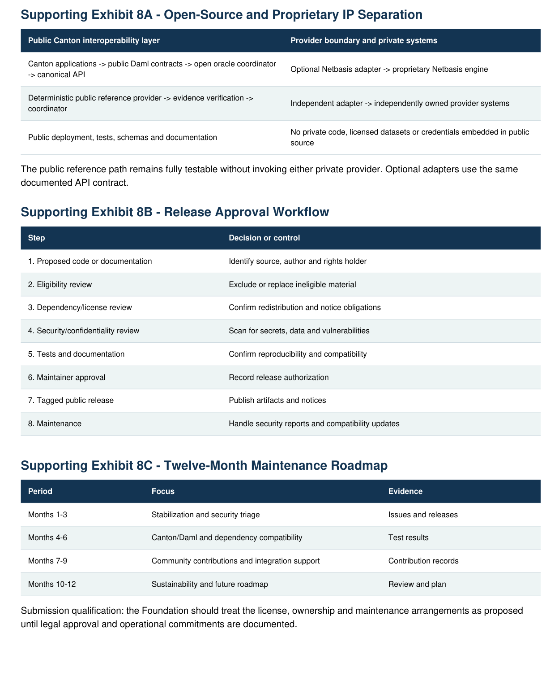
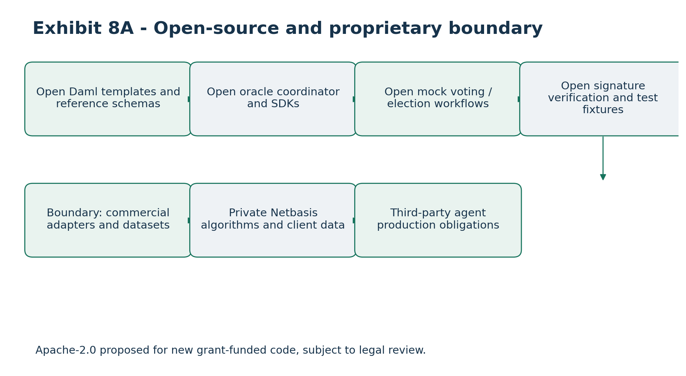
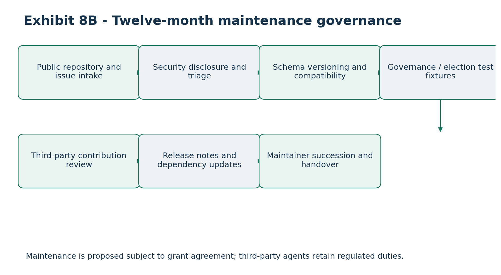

# Intellectual Property Separation, Open-Source Licensing, Governance and Long-Term Sustainability Plan

### Canton Open Tax-Lot Interoperability and Proof-of-Basis Infrastructure

Applicant: Token Path LLC \| Duration: 24 weeks

Grant request: Up to 1,900,000 CC

Proposed license: Apache License 2.0 (subject to legal review)

Maintenance plan: 12 months following release

Version: 1.0 - Proposed IP and Governance Plan

The Foundation-funded public infrastructure is designed to function independently of proprietary Netbasis services. Existing IP rights, license selection, patent implications, contributor rights and maintenance commitments require final legal and operational validation.

## 1. Executive Overview

Token Path proposes open-source Canton-native economic-data interoperability infrastructure for authorized tax-lot references, provider-neutral calculations, signed Proof-of-Basis attestations and reconciliation. The public project must remain separate from proprietary Netbasis technology and independent third-party systems.

• Grant-funded public components: Daml contracts, canonical APIs, oracle coordination, verification and reference deployments

• Existing proprietary technology: Netbasis engines, methodologies, datasets and private customer systems

• Third-party technology: external providers and dependencies subject to their own rights

• Confidential institutional information: excluded from public release

A deterministic public reference provider must enable building, testing and demonstrating the complete reference workflow without Netbasis credentials or subscriptions.

## 2. Objectives of the IP Framework

• Publish reusable infrastructure under a recognized open-source license

• Preserve lawful ownership of pre-existing proprietary technology

• Prevent mandatory proprietary dependencies

• Document rights and chain of title

• Permit independent provider participation

• Define contribution and release governance

• Provide twelve-month maintenance planning

• Comply with final Foundation grant terms

## 3. Intellectual Property Classification

### Class Scope Treatment

A - Public grant-funded Daml, APIs, coordinator, mock provider, verification Open-source release

B - Existing proprietary Netbasis engines, algorithms, data and private systems Rights retained by owners

C - Third-party Canton/Daml dependencies and external provider systems Underlying licenses apply

D - Confidential Customer records, taxpayer data, credentials Never in public release

The IP register will record component, origin, rights holder, license, public-release eligibility, dependency restrictions and approval. Review occurs at design, dependency addition, external contribution, integration and release.

## 4. Grant-Funded Public Infrastructure

### 4.1 Daml contract framework

• TaxOracleRequest and TaxOracleResponse

• TaxLotReference and BasisAdjustmentReference

• CorporateActionNotice and DividendEventNotice

• ProofOfBasisAttestation and ReconciliationException

• Documented party authorization and tests

### 4.2 Canton Ledger API connector

An authenticated connector will consume authorized events, normalize application messages, maintain processing references, support command submission, manage duplicates and record outcomes.

### 4.3 Oracle coordination

A provider-neutral coordinator will validate requests, route calculations, manage durable state, handle timeouts and retries, coordinate evidence and reconcile exceptions.

### 4.4 Canonical specifications

OpenAPI and schema definitions will cover assets, lots, acquisitions, dispositions, basis adjustments, corporate actions, dividends, attestations and reconciliation.

### 4.5 Public reference provider and verification

A deterministic synthetic-data provider will demonstrate calculation interfaces; public evidence utilities will create and verify commitments, signatures, versions and status. It is not represented as a comprehensive institutional tax engine.

### 4.6 Deployment and developer tooling

• Container definitions and deployment examples

• Build and configuration instructions

• Synthetic fixtures and automated tests

• Documentation and security reporting procedures

## 5. Pre-Existing Proprietary Netbasis Technology

The grant does not finance, reproduce, disclose or transfer proprietary Netbasis calculation algorithms, wash-sale methods, corporate-action methodologies, income reclassification logic, withholding/reporting systems, historical data, private client infrastructure or trade secrets. Rights remain with the respective lawful owners.

Publication of the public framework does not itself grant rights to proprietary source code, databases, trademarks or commercial services. Netbasis may participate through an optional adapter; no proprietary credentials or datasets are required for the public reference workflow.

## 6. Public/Proprietary Boundary Architecture

Public layer: Daml contracts, Ledger API connector, coordinator, canonical API, reference provider, evidence verification and reconciliation. Private layer: Netbasis, other independent calculation providers, licensed financial data and institutional systems.

• Use a published provider-neutral API rather than embedding proprietary code

• Separate repositories and deployment environments as appropriate

• Maintain distinct credentials and access policies

• Review dependencies and release artifacts

• Demonstrate public workflow using only open reference components

## 7. Proposed Open-Source License

Apache License 2.0 is proposed, subject to legal, patent and dependency review. The intended model permits independent commercial and noncommercial use, modification, redistribution and derivatives, subject to the actual license terms.

• Include the applicable license text and copyright notices

• Maintain required attribution and third-party notices

• Review contributor patent licensing and patent-termination implications

• Confirm compatibility with Foundation grant conditions and third-party terms

Legal qualification: A proprietary-exclusion statement cannot negate license rights arising from code actually contributed under Apache-2.0. Counsel must review background IP and any applicable patent portfolio before release.

## 8. Third-Party Dependencies

Maintain a dependency register with package name, version, source, license, purpose, redistribution obligations and security status. Review compatibility, replace or exclude restricted components and publish an SBOM or equivalent inventory. Canton and Daml distributions retain their own licensing requirements; the project license does not automatically govern them.

## 9. Source-Code Ownership and Chain of Title

Record lawful ownership of all public code and documentation. Employee and contractor agreements should address developed work, pre-existing materials, confidentiality, third-party rights and permission to publish. External contributors must certify authority to submit code. Unresolved ownership questions block release of the affected material.

## 10. Public Repository Structure

### Directory Primary purpose

/daml-contracts Authorized contract templates

/ledger-connector Canton integration

/oracle-coordinator Provider-neutral workflow

/canonical-api Schemas and specifications

/reference-provider Deterministic public implementation

/proof-of-basis Evidence signing and verification

/reconciliation Consistency and exception logic

/deployment, /tests, /examples Reproducible operations and tests

/docs, /security, /governance Documentation, disclosure and contribution policies

The repository will include README, LICENSE, contribution rules, security policy, build instructions, versioning and release notes. It will exclude Netbasis proprietary code, licensed datasets, production secrets, customer records and restricted third-party sources.

## 11. Contribution Governance

Pull requests will identify the change, affected interfaces, test evidence, security considerations, documentation and applicable rights. Maintainers will review correctness, compatibility, provider neutrality, maintainability and license compliance. A Developer Certificate of Origin or contributor agreement may be adopted after legal review.

## 12. Technical Governance

• Maintainers: reviews, issues, dependencies, security and releases

• Technical lead: Daml, API and oracle architecture decisions

• Security owner: vulnerability handling and remediation

• Token Path sponsor: grant deliverables and reporting

• Community: issues, proposals and contributions under published procedures

Material authorization and security changes should receive independent qualified review where practical.

## 13. Architecture Decision Records

Version-controlled decisions will document problem, alternatives, selected approach, security and compatibility implications, IP effects, approval and date. Mandatory review areas include Daml authorization, provider identity, signing algorithms, schema evolution, Canton version support and major dependency changes.

## 14. Release Governance

A release requires passing automated tests, security review, license/dependency approval, updated documentation, release notes and maintainer approval. Tagged deliverables include source, Daml artifacts, OpenAPI schemas, reference provider, fixtures and deployment instructions. Breaking changes must be documented, including effects on historical attestations.

## 15. Security Governance

Publish a vulnerability reporting channel, confidential handling process, severity triage, remediation responsibility and appropriate advisories. The independent security assessment described in Attachment 5 will inform release approval; its existence and results must not be claimed before completion.

## 16. Public Reference Provider Independence

The reference provider must implement canonical endpoints, accept synthetic inputs, return deterministic results and support representative acquisitions, dispositions, corporate actions and dividend scenarios. It must generate evidence suitable for attestation verification without private Netbasis access.

• Independent build and deployment

• Schema compliance and authorized requests

• Deterministic output and signed evidence

• Verification, reconciliation and controlled exceptions

The reference implementation is a demonstration of interoperability, not a certified comprehensive tax engine.

## 17. Independent Provider Participation

Independent providers can review the public API, implement calculation endpoints, authenticate to the coordinator, return standardized outputs and evidence, reconcile results and pass compatibility tests. The open framework does not require exclusive registration with Token Path. Providers retain responsibility for their own methodologies, data rights and tax accuracy.

## 18. Data Rights and Confidentiality

Do not publish licensed financial data without redistribution rights. Public examples use synthetic or appropriately licensed data. Customer/taxpayer records, private credentials and sensitive institutional architecture are excluded. Evidence commitments and access controls should minimize disclosure. Using the framework does not itself transfer institutional data ownership.

## 19. Trademark and Branding

Token Path and Netbasis marks remain subject to their owners rights. Canton-related marks must follow applicable brand rules. Open-source software licensing does not itself grant trademark rights or imply Foundation endorsement. Technical compatibility and formal certification must be distinguished.

## 20. IP Review Gates

### Gate Required review

1 - Architecture Classify components and identify public/proprietary boundary

2 - Repository Verify ownership and dependency inventory

3 - Integration Ensure private providers connect via public interfaces

4 - Pre-release Check secrets, data, license notices and restricted code

5 - Final approval Approve license, contributor records and release artifacts

## 21. IP Compliance Test Matrix

### Test Control / expected evidence

IP-001 Public code rights register

IP-002 Proprietary Netbasis code excluded

IP-003 Independent mock provider reproducible

IP-004 Third-party dependency licenses inventoried

IP-005 License compatibility reviewed

IP-006 Contributor authority documented

IP-007 Secrets scan passes

IP-008 Customer data excluded from fixtures

IP-009 License and attribution notices reviewed

IP-010 Public API independent of Netbasis

IP-011 Security disclosure policy published

IP-012 Governance and release procedures documented

IP-013 Named maintenance owner confirmed

IP-014 Reproducible public build

IP-015 Independent provider interface tested

## 22. Open-Source Sustainability

For twelve months after release, the proposed maintenance program prioritizes critical bug fixes, security updates, compatibility, dependencies, documentation, community triage and versioned releases. Token Path will identify accountable maintainers before final acceptance. Future funding may involve internal resources, contributors, sponsorship or commercial services, but none is assumed committed.

## 23. Twelve-Month Maintenance Plan

### Quarter Primary work Evidence

Q1 - Stabilization Release defects, security triage, deployment docs Issue and release records

Q2 - Compatibility Canton/Daml and dependency updates, API tests Compatibility reports

Q3 - Community Review contributions, expand examples and adapters Contribution records

Q4 - Sustainability Evaluate adoption, ownership and forward roadmap Maintenance review

Named owners, staffing availability and financial support must be confirmed before release; the table is a proposed planning framework.

## 24. Maintenance Service Objectives

Document realistic triage expectations for vulnerabilities, critical defects, dependency updates, documentation and community issues. Response times will be set based on confirmed capacity; this proposal does not establish an unapproved commercial service-level agreement.

## 25. Governance Risk Register

### Risk Mitigation

Proprietary code exposure Classification and release checks

Unclear contributor rights Written terms and chain-of-title review

Incompatible license Dependency screening

Apache patent implications Specialist legal review

Netbasis dependency Public mock-provider acceptance

Maintainer turnover Ownership records and runbooks

Security defect Disclosure and remediation policy

Unsupported Canton version Compatibility testing

Limited adoption Public onboarding and pilots

Maintenance funding gap Capacity planning and sustainability review

Trademark misuse Branding rules

Confidential-data disclosure Data review and secrets scans

## 26. Milestone-Based IP and Governance Deliverables

### Milestone Proposed deliverables

M1 - Weeks 1-4 IP register, boundary architecture, license proposal, contributor framework

M2 - Weeks 5-10 Public repository, interfaces, reference foundation, notices and guidelines

M3 - Weeks 11-16 Expanded public code, compatibility tests, updated register and dependency inventory

M4 - Weeks 17-20 Independent security review, remediation, license checks and reproducible deployment

M5 - Weeks 21-24 Tagged release, final rights review, independent integration evidence and maintenance plan

## 27. Foundation Oversight and Transparency

Reviewable evidence will include public repository and tags, Daml packages, API schemas, tests, dependency inventory, security assessment, contribution policies, IP separation checklist and maintenance documents. Confidential legal agreements may require restricted handling. The final grant agreement governs Foundation review rights.

## 28. Open-Source Acceptance Criteria

• Public source is accessible and license legally approved

• Notices and dependencies are documented

• Reference provider builds and runs without Netbasis

• Daml contracts, APIs and tests are published

• Security policy and reproducible deployment are available

• Independent integration evidence is reviewable

• Named maintenance responsibilities are recorded

• Material IP and licensing issues are resolved

• Final artifacts satisfy approved Foundation terms

## 29. Long-Term Ecosystem Value

Open interfaces can reduce duplicated integrations, enable provider competition, support cryptographically verifiable calculation provenance and preserve institutional privacy through off-ledger records. Long-term value depends on independent use, code quality, continued compatibility and maintained security rather than licensing alone.

## 30. Conclusion

The proposed governance model separates grant-funded Canton interoperability infrastructure from pre-existing proprietary Netbasis technology. The public Daml contracts, provider-neutral APIs, oracle coordinator, deterministic reference provider, evidence verification and developer tooling are intended to remain independently operable. Apache-2.0 is proposed subject to legal review, with controlled contributions, documented rights, secure releases and a twelve-month maintenance framework.

Status: Proposed specification. Ownership, patent licensing, contributor terms, third-party licenses and named maintenance commitments remain subject to final validation.

## Supporting Exhibit 8A - Open-Source and Proprietary IP Separation

### Public Canton interoperability layer Provider boundary and private systems

Canton applications -\> public Daml contracts -\> open oracle coordinator -\> canonical API Optional Netbasis adapter -\> proprietary Netbasis engine

Deterministic public reference provider -\> evidence verification -\> coordinator Independent adapter -\> independently owned provider systems

Public deployment, tests, schemas and documentation No private code, licensed datasets or credentials embedded in public source

The public reference path remains fully testable without invoking either private provider. Optional adapters use the same documented API contract.

## Supporting Exhibit 8B - Release Approval Workflow

### Step Decision or control

## 1. Proposed code or documentation Identify source, author and rights holder

## 2. Eligibility review Exclude or replace ineligible material

## 3. Dependency/license review Confirm redistribution and notice obligations

## 4. Security/confidentiality review Scan for secrets, data and vulnerabilities

## 5. Tests and documentation Confirm reproducibility and compatibility

## 6. Maintainer approval Record release authorization

## 7. Tagged public release Publish artifacts and notices

## 8. Maintenance Handle security reports and compatibility updates

## Supporting Exhibit 8C - Twelve-Month Maintenance Roadmap

### Period Focus Evidence

Months 1-3 Stabilization and security triage Issues and releases

Months 4-6 Canton/Daml and dependency compatibility Test results

Months 7-9 Community contributions and integration support Contribution records

Months 10-12 Sustainability and future roadmap Review and plan

Submission qualification: the Foundation should treat the license, ownership and maintenance arrangements as proposed until legal approval and operational commitments are documented.

# Governance and Voluntary Corporate-Action Election Extension

Alignment with Attachment 1: provider-neutral proxy voting and voluntary corporate-action election reference workflows, planned within the existing 24-week, 1,900,000 CC funding envelope.

## Open-source boundary for governance and election modules

Grant-funded public artifacts may include governance/election reference schemas, Daml templates, mock voting/election agents, example API clients, status reconciliation logic, test fixtures and documentation. Existing proprietary proxy distribution, tabulation, custody, corporate-action election execution, investor identity systems and licensed data remain outside the public deliverable unless separately contributed with rights clearance.

## Intellectual property and service responsibility matrix

| **Artifact or function**                         | **Proposed treatment**                                | **Responsibility boundary**      |
|--------------------------------------------------|-------------------------------------------------------|----------------------------------|
| Proxy / election schemas                         | Public open-source reference                          | Token Path grant deliverable     |
| Daml reference contracts                         | Public open-source reference                          | Permissioned contract logic      |
| Mock voting/election agent                       | Public deterministic test fixture                     | Not production execution         |
| ProxyFlow or other commercial governance service | Background or separate commercial IP where applicable | No mandatory license             |
| Beneficial entitlement records                   | Institutional confidential data                       | Custodian/intermediary authority |
| Official vote tabulation                         | External regulated/service process                    | Authorized voting agent          |
| Corporate-action election execution              | External agent/service process                        | Authorized election agent        |

## License and contribution governance

Apache-2.0 remains the proposed license for new grant-funded code, subject to counsel review of background IP and patent implications. Contributors must warrant or document appropriate rights to event schemas, sample data and interfaces; the public repository must not contain investor records, credentials, commercial proxy service code or restricted election materials.

## Long-term maintenance

The proposed twelve-month maintenance commitment will cover compatibility and security updates for the new reference schemas, mock fixtures, authorization examples and issue triage. The project must remain usable without purchasing Netbasis, ProxyFlow or any other proprietary Token Path service.

## Implementation and regulatory boundary

The governance and election workflows are proposed provider-neutral reference capabilities. They do not constitute a production proxy tabulator, voting agent, transfer agent, custodian or corporate-action election agent. Authorized intermediaries remain responsible for legal entitlement, cutoffs, instruction execution and final outcomes. Mock demonstrations do not imply live partner integration.

# Visual exhibits and architecture diagrams

## Exhibits 8A-8C - IP boundaries, release and maintenance

Exhibit from the source proposal, retained as a high-resolution image.

# Recreated and Updated Visual Exhibits

The following proposed reference diagrams extend the source architecture and supporting exhibits to include proxy voting and voluntary corporate-action elections. Existing source exhibits and tables remain in the document.

## Exhibit 8A - Open-source and proprietary boundary

Apache-2.0 proposed for new grant-funded code, subject to legal review.

## Exhibit 8B - Twelve-month maintenance governance

Maintenance is proposed subject to grant agreement; third-party agents retain regulated duties.
